# Лабораторная работа № 1
##Жизнь и страдания небольшого HTTP-сервиса

**Выполнили:** [Ивановский Р.Е. Аннин М.Д.]  
**Дисциплина:** Администрирование информационно-коммуникационных технологий

---

# 1. Цель работы

Цель работы — создать небольшой HTTP-сервис и настроить для него систему мониторинга.

В ходе лабораторной работы необходимо было реализовать:

- сбор метрик приложения;
- сбор и просмотр логов;
- отслеживание запросов с помощью трейсов;
- визуализацию данных в Grafana;
- оповещения при возникновении проблем с приложением.

Для выполнения работы привлекались по разным статьям Docker, Prometheus, Grafana, Loki, Grafana Alloy, OpenTelemetry, Jaeger и Alertmanager.

# 2. Создание HTTP-сервиса

## 2.1. Структура проекта

Для начала была создана папка проекта и подготовлена структура файлов приложения.

В проекте используются Python, FastAPI и Uvicorn.

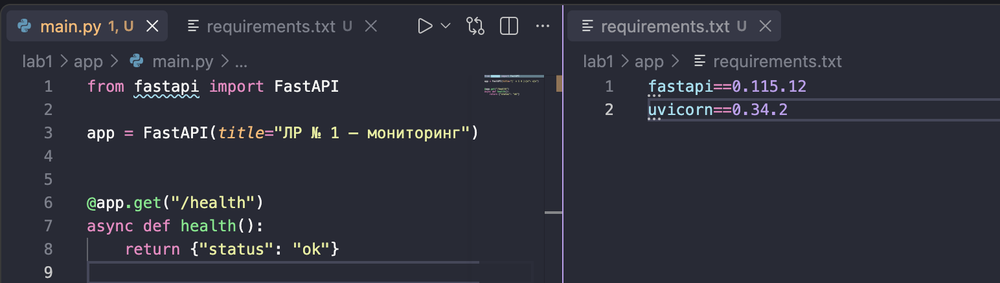

*Рисунок 1 — Структура файлов HTTP-сервиса.*

## 2.2. Реализация приложения

Было разработано небольшое веб-приложение с тремя кнопками для проверки работы мониторинга(пока все вроде не сложно).

Реализованы следующие сценарии:

| Кнопка | Действие |
|---|---|
| Создать ошибку | Возвращает HTTP 500 |
| Создать задержку | Задерживает ответ примерно на 2 секунды |
| Нагрузка | Отправляет 30 параллельных запросов к `/health` |

Также реализованы эндпоинты:

- `/health` — проверка состояния приложения;
- `/metrics` — получение метрик для Prometheus;
- `/error` — создание ошибки;
- `/delay` — создание задержки;
- `/load` — генерация нагрузки.

## 2.3. Проверка приложения

После создания приложения была проверена работа эндпоинта `/health`.

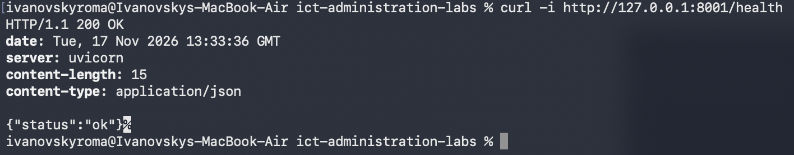

*Рисунок 2 — Проверка доступности приложения.*

Для запуска приложения был создан Dockerfile. После этого приложение было собрано и запущено в Docker-контейнере раза с третьего.

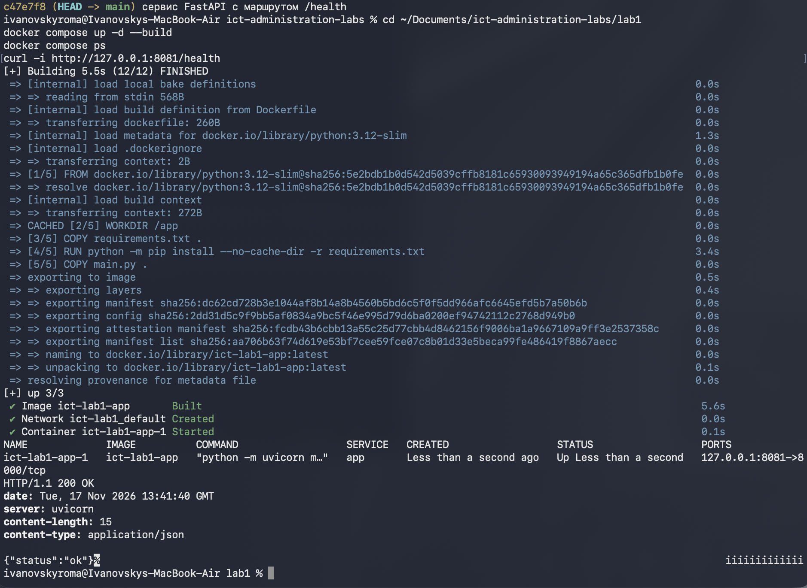

*Рисунок 3 — Проверка состояния Docker-контейнера.*

## 2.4. Веб-интерфейс приложения

Для удобства проверки был создан максимально ~~жалкий~~ простой веб-интерфейс.

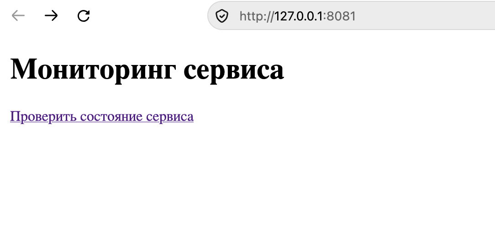

*Рисунок 4 — Главная страница приложения.*

После открытия страницы была проверена работа интерфейса.

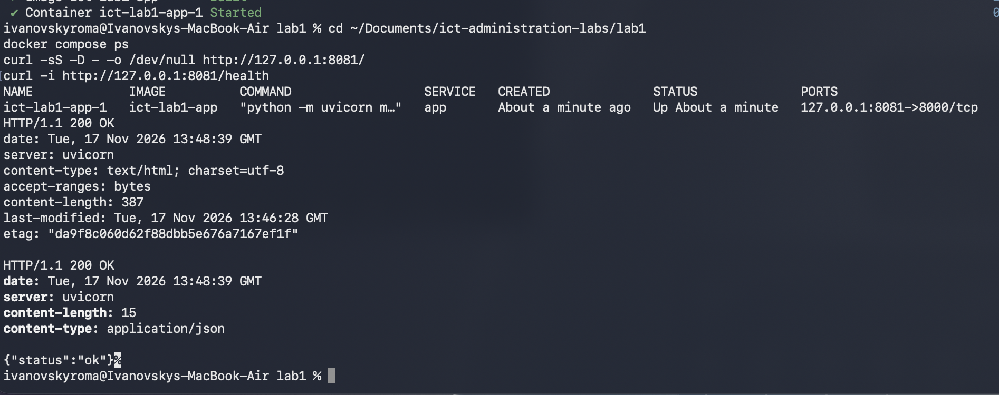

*Рисунок 5 — Проверка отображения элементов приложения.*

Ура все вроде работает.

## 2.5. Проверка сценариев

Сначала была проверена генерация ошибок и задержек.

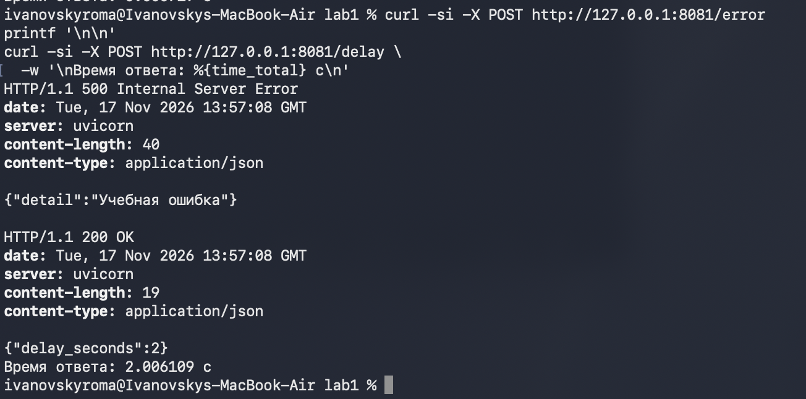

*Рисунок 6 — Проверка HTTP-ответов при создании ошибки и задержки.*

Затем те же действия были выполнены через веб-интерфейс, ничего не сломалось спасибо.

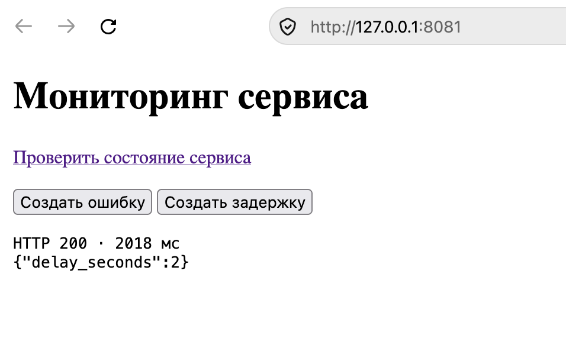

*Рисунок 7 — Результаты выполнения сценариев через веб-интерфейс.*

Для проверки нагрузки был запущен сценарий, отправляющий 30 параллельных запросов.

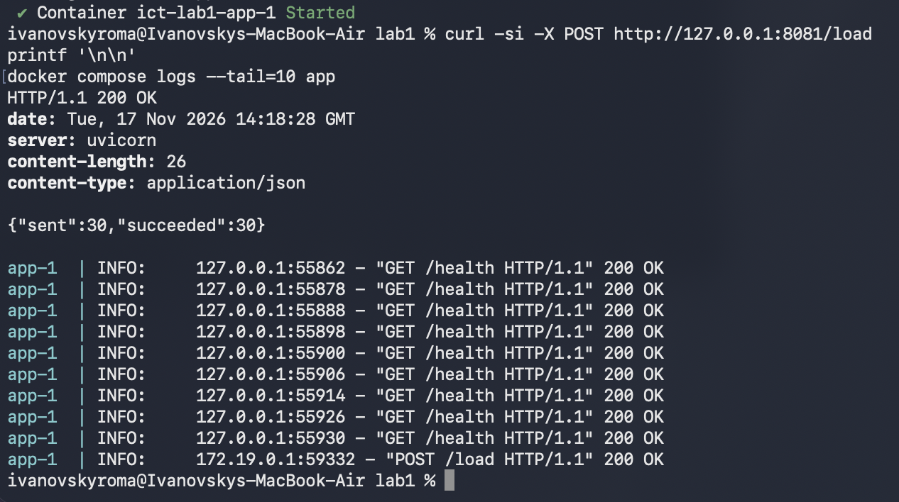

*Рисунок 8 — Результат выполнения запросов нагрузки.*

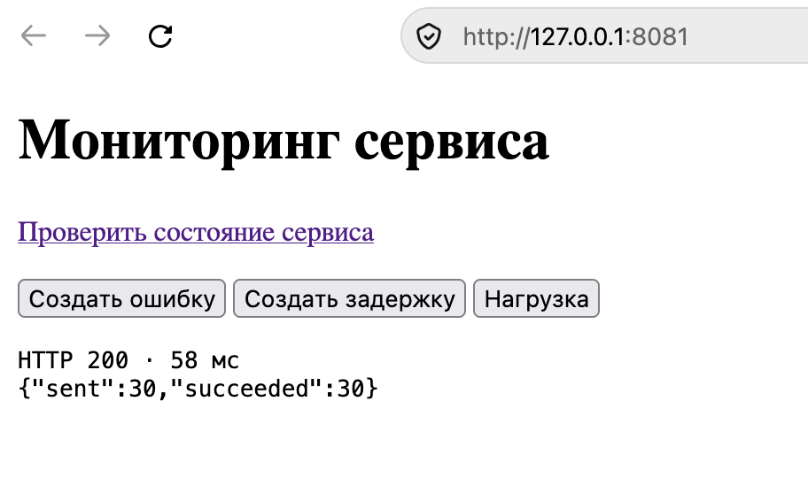

*Рисунок 9 — Результат сценария нагрузки в веб-интерфейсе.*

Таким образом, приложение было подготовлено для дальнейшего подключения системы мониторинга ибо выдержало столь страшную нагрузку.

# 3. Развёртывание инфраструктуры

## 3.1. Docker Compose

Для запуска всех компонентов использовался так называемый Docker Compose.

В файле `compose.yaml` описаны восемь сервисов:

| Сервис | Назначение |
|---|---|
| app | HTTP-приложение |
| jaeger | Сбор и просмотр трейсов |
| prometheus | Сбор метрик |
| grafana | Визуализация данных |
| loki | Хранение логов |
| alloy | Сбор логов контейнеров |
| alertmanager | Обработка оповещений |
| alert-webhook | Приём уведомлений |

Все контейнеры работают в общей сети Docker Compose и обращаются друг к другу по именам сервисов.

Для сохранения данных используются Docker volumes:

- `grafana-data`;
- `loki-data`;
- `alloy-data`.

## 3.2. Запуск инфраструктуры

Для запуска проекта используется команда:

```bash
docker compose up -d --build
```

Проверить состояние контейнеров можно командой:

```bash
docker compose ps
```

Для просмотра логов приложения:

```bash
docker compose logs -f app
```

На macOS перед запуском Alloy дополнительно указывается путь к Docker Socket (если вдруг вам это интересно):

```bash
export LAB_DOCKER_SOCKET="$HOME/.docker/run/docker.sock"
```

# 4. Сбор и визуализация метрик

## 4.1. Настройка Prometheus

Для сбора метрик был использован Prometheus.

Приложение предоставляет метрики по адресу прописки:

```text
http://app:8000/metrics
```

В конфигурации Prometheus настроен сбор данных с интервалом 5 секунд.

В качестве цели сбора указан контейнер `app` на порту 8000.

Основные метрики приложения:

- `http_requests_total` — общее количество HTTP-запросов;
- `http_errors_total` — количество ответов с ошибками 5xx;
- `http_request_duration_seconds` — время обработки запросов.

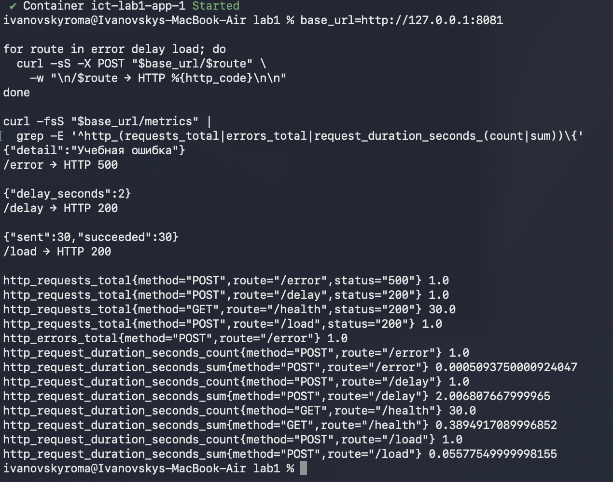

*Рисунок 10 — Метрики HTTP-сервиса.*

Дополнительно проверена работа JSON-логирования приложения.

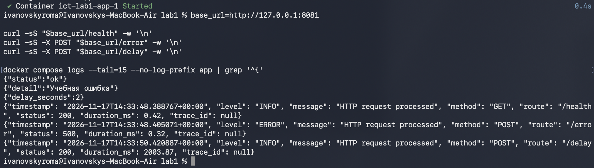

*Рисунок 11 — Пример структурированных логов приложения которые дай бог нас не покинут.*

## 4.2. Проверка Prometheus

После запуска Prometheus была проверена доступность приложения в списке целей сбора данных.

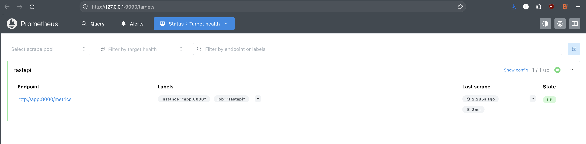

*Рисунок 12 — Успешное подключение HTTP-сервиса к Prometheus.*

Затем был выполнен запрос для просмотра количества HTTP-запросов:

```promql
http_requests_total{job="fastapi"}
```

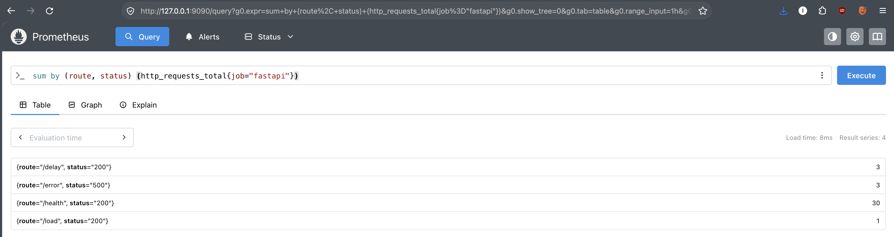

*Рисунок 13 — Просмотр метрик HTTP-запросов в Prometheus.*

Все работает все показывает все круто.

## 4.3. Подключение Grafana

Для визуализации метрик была развёрнута Grafana.

В качестве источника данных добавлен как раз наш Prometheus:

```text
http://prometheus:9090
```

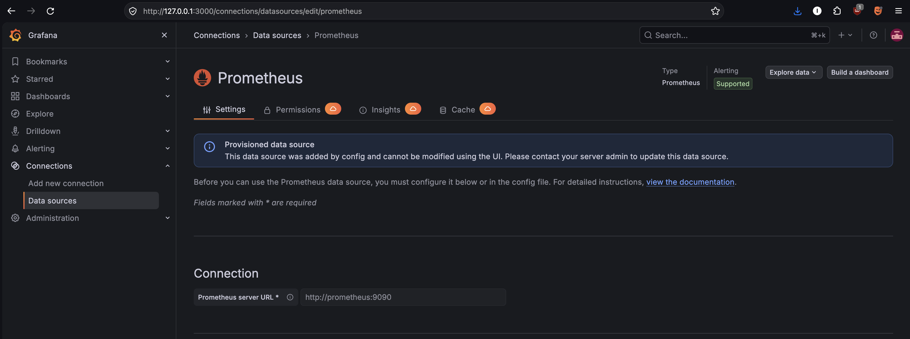

*Рисунок 14 — Подключение Prometheus к Grafana.*

После подключения был выполнен тестовый запрос:

```promql
up{job="fastapi"}
```

Результат `1` означает, что Prometheus успешно собирает метрики приложения и ничего не поломалось.

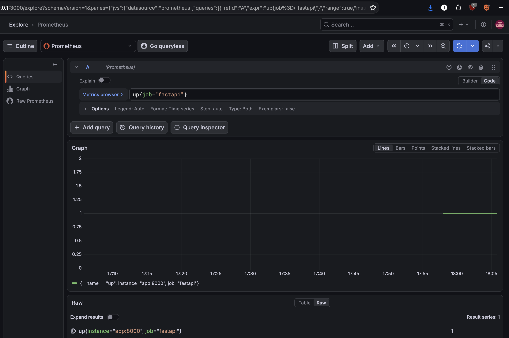

*Рисунок 15 — Проверка получения метрик через Grafana.*

## 4.4. Создание RED-дашборда

В Grafana был создан дашборд `RED — FastAPI`, состоящий из трёх панелей.

**1. Запросы в секунду (Request Rate)**

```promql
sum(rate(http_requests_total{job="fastapi"}[1m]))
```

Должен показывать интенсивность поступающих запросов.

**2. Доля ошибок 5xx (Error Rate)**

```promql
100 *
(sum(rate(http_errors_total{job="fastapi"}[1m])) or vector(0))
/
clamp_min(sum(rate(http_requests_total{job="fastapi"}[1m])), 1e-9)
```

Это процент запросов, завершившихся ошибками.

**3. Время ответа p95 (Duration)**

```promql
histogram_quantile(
  0.95,
  sum by (le) (
    rate(http_request_duration_seconds_bucket{job="fastapi"}[1m])
  )
)
```

А это показывает 95-й перцентиль времени обработки запросов.

Все вместе нам это дает вот такую красоту:

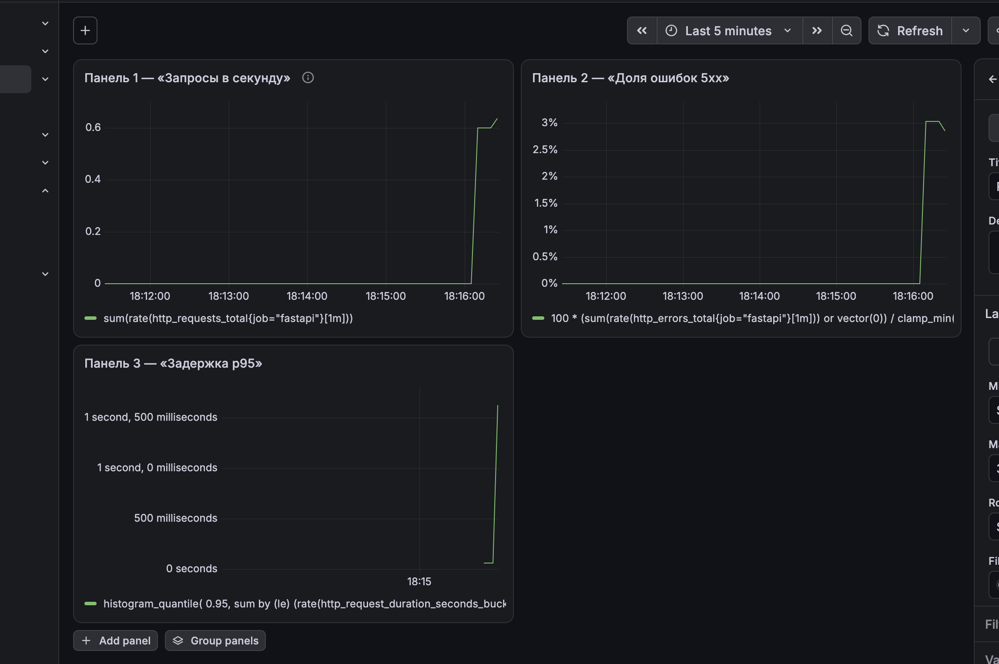

*Рисунок 16 — Итоговый RED-дашборд в Grafana.*

## 4.5. Автоматическая загрузка дашборда

Для автоматической загрузки дашборда была создана конфигурация Grafana Provisioning.

Сам dashборд хранится в репозитории в формате JSON:

```text
grafana/dashboards/red-fastapi.json
```

При запуске Grafana автоматически загружает его из указанной папки. И это очень удобно.

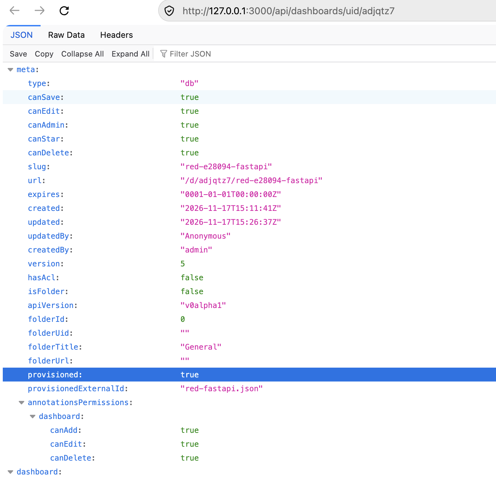

*Рисунок 17 — Проверка автоматической загрузки дашборда.*

# 5. Сбор и просмотр логов

## 5.1. Настройка Loki

Для хранения логов был развёрнут Loki.

Он получает данные от Grafana Alloy и позволяет выполнять поиск по записям приложения ~~и обманывать людей~~.

Loki использует файловое хранилище, а данные сохраняются в Docker volume `loki-data`.

После запуска была проверена готовность сервиса.

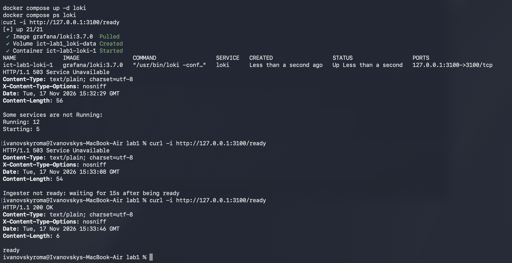

*Рисунок 18 — Он готов.*

## 5.2. Подключение Loki к Grafana

В Grafana был добавлен второй источник **достоверных** данных — Loki.

Адрес подключения:

```text
http://loki:3100
```

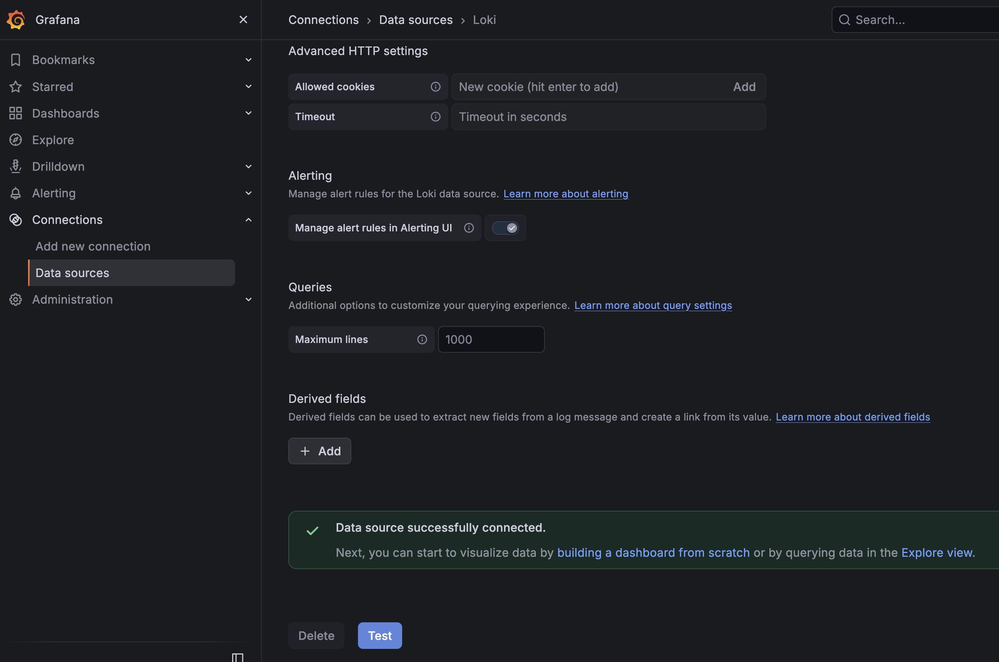

*Рисунок 19 — Успешное подключение Loki к Grafana.*

До сих пор все идет на самом деле довольно гладко, что удивительно.

## 5.3. Настройка Grafana Alloy

Для сбора логов используется Grafana Alloy.

Он обнаруживает Docker-контейнеры проекта и выбирает контейнер приложения `app`.

После этого Alloy передаёт логи в Loki.

Для записей используется метка:

```text
service_name="ict-lab1-app"
```

Логи приложения формируются в JSON и содержат следующие поля:

- `timestamp` — время события;
- `level` — уровень записи;
- `message` — сообщение;
- `method` — HTTP-метод;
- `route` — маршрут;
- `status` — HTTP-статус;
- `duration_ms` — время обработки;
- `trace_id` — идентификатор трейса.

## 5.4. Поиск ошибок в Grafana

Для проверки была создана ошибка через эндпоинт `/error`.

После этого запись была найдена в Grafana Explore с помощью запроса LogQL:

```logql
{service_name="ict-lab1-app"}
| json
| __error__=""
| level="ERROR"
| route="/error"
```

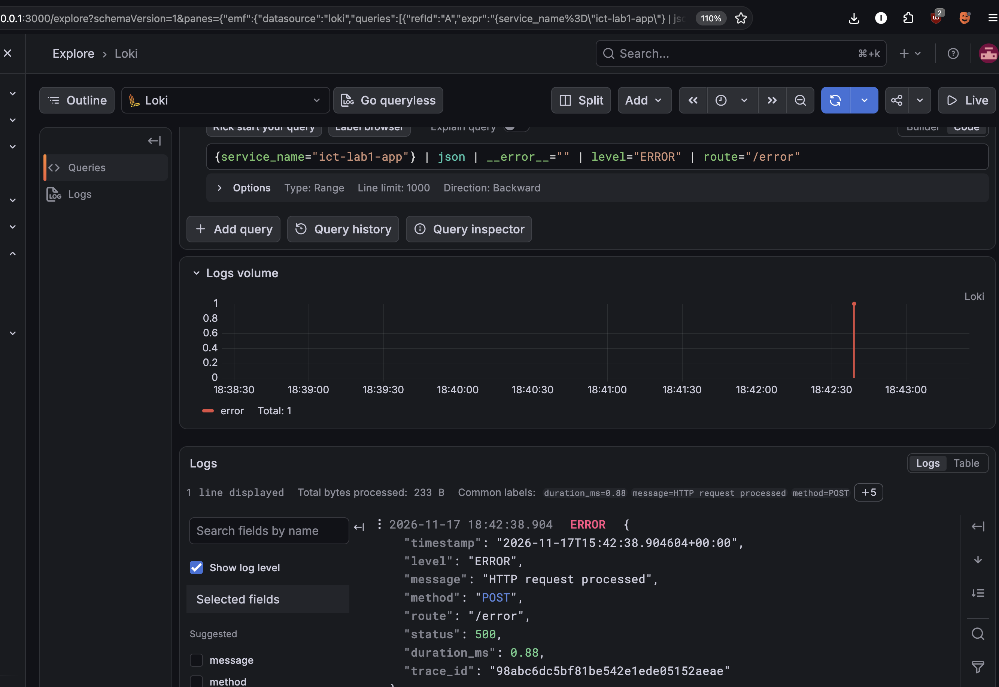

*Рисунок 20 — Поиск ошибки HTTP 500 в Loki.*

Таким образом, удалось получить запись об ошибке и посмотреть её дополнительные поля и мало что понять.

# 6. Распределённая трассировка

## 6.1. Настройка OpenTelemetry и Jaeger

Для отслеживания запросов используется OpenTelemetry.

В приложении подключено автоматическое инструментирование FastAPI. Оно создаёт трейсы для входящих HTTP-запросов.

Для медленного обработчика `/delay` дополнительно создаётся вложенный спан:

```text
slow-dependency
```

В обработчике `/error` текущий спан помечается как ошибочный.

Для передачи трейсов используется протокол OTLP/HTTP.

В Docker Compose указан адрес Jaeger:

```text
http://jaeger:4318/v1/traces
```

Jaeger используется для просмотра полученных трейсов и анализа отдельных запросов.

## 6.2. Проверка задержек

Для проверки был вызван эндпоинт `/delay`.

В Jaeger найден соответствующий трейс, в котором видно время выполнения вложенного спана `slow-dependency`.

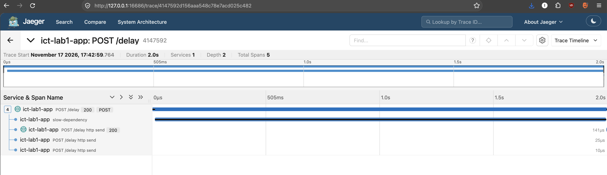

*Рисунок 21 — Трейс запроса с задержкой в Jaeger.*

## 6.3. Проверка ошибок

Затем был вызван эндпоинт `/error`.

В Jaeger найден трейс с ошибочным спаном.

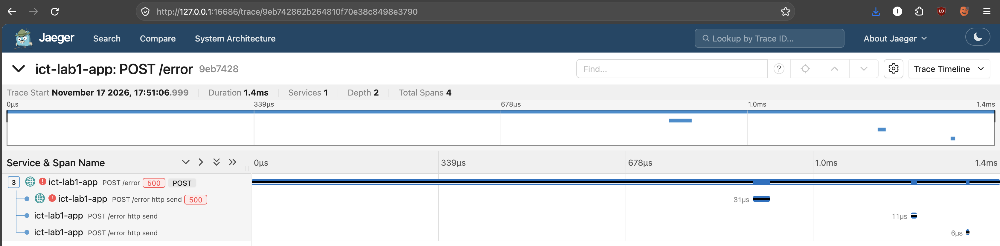

*Рисунок 22 — Трейс запроса с ошибкой.*

## 6.4. Связь логов и трейсов

Для связи логов с трассировками в JSON-логи добавляется такая вещь как `trace_id`.

В Grafana Loki настроено извлечение идентификатора из JSON-записи и формирование ссылки на соответствующий трейс в Jaeger.

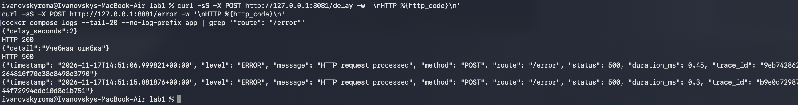

*Рисунок 23 — Идентификатор трейса в JSON-логе.*

В Grafana была проверена ссылка для перехода к соответствующему трейсу.

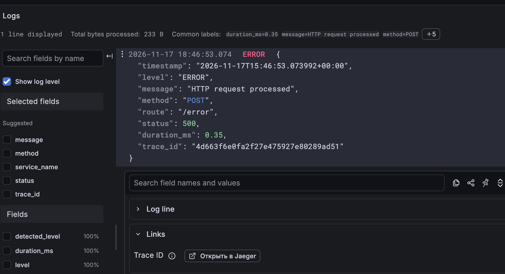

*Рисунок 24 — Ссылка для перехода из лога в Jaeger.*

После нажатия открывается нужный трейс в Jaeger (невероятно).

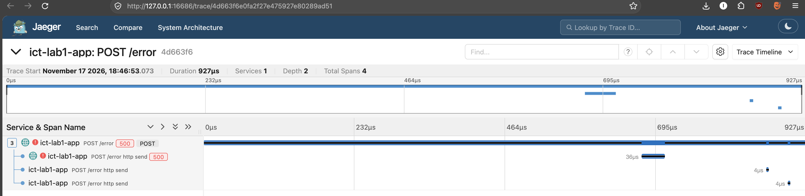

*Рисунок 25 — Открытие трейса в Jaeger по идентификатору из лога.*

Таким образом, удалось связать запись об ошибке с конкретным запросом и посмотреть его трассировку. Это успех.

# 7. Настройка оповещений

## 7.1. Подключение Alertmanager

Для обработки оповещений был развёрнут Alertmanager.

Он получает уведомления от Prometheus и передаёт их настроенному получателю.

В конфигурации Prometheus указан адрес:

```text
alertmanager:9093
```

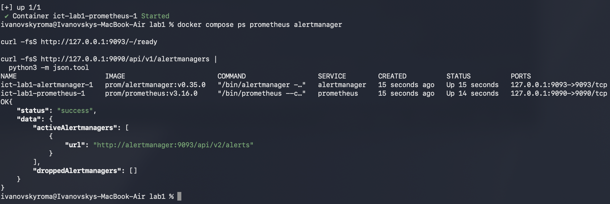

*Рисунок 26 — Проверка подключения Alertmanager к Prometheus.*

## 7.2. Создание правил оповещений

В Prometheus были настроены три правила для отслеживания основных проблем приложения.

| Название | Условие | Что обнаруживает |
|---|---|---|
| `FastAPIHighErrorRate` | Доля ошибок выше 20% | Большое количество ошибочных ответов |
| `FastAPIHighRequestRate` | Более 2 запросов в секунду | Повышенную нагрузку |
| `FastAPIHighLatencyP95` | p95 выше 1 секунды | Замедление обработки запросов |

Для каждого правила установлено условие `for: 10s`.

Это означает, что условие должно сохраняться не менее 10 секунд, прежде чем оповещение перейдёт в состояние `FIRING`. А до этого ничего страшного.

### 7.2.1. Высокая доля ошибок

Алерт `FastAPIHighErrorRate` срабатывает, когда доля ответов 5xx превышает 20%.

Он позволяет обнаружить проблемы с обработкой HTTP-запросов если таковые появляются.

### 7.2.2. Высокая интенсивность запросов

Алерт `FastAPIHighRequestRate` срабатывает, когда интенсивность запросов превышает 2 запроса в секунду.

Он позволяет обнаружить резкое увеличение нагрузки на приложение. Например увидеть какую-нибудь DDos атаку.

### 7.2.3. Высокая задержка

Алерт `FastAPIHighLatencyP95` срабатывает, когда p95 превышает одну секунду.

Он позволяет обнаружить замедление работы приложения. Если вдруг мы попадем в некий "список"

## 7.3. Проверка срабатывания алертов

Для проверки были использованы три сценария приложения:

- несколько запросов к `/error`;
- генерация нагрузки через `/load`;
- запросы к `/delay`.

После этого в Prometheus были проверены состояния правил.

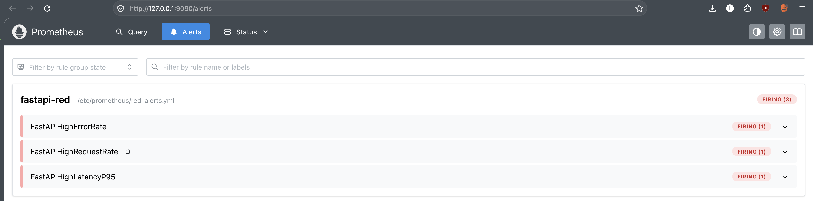

*Рисунок 27 — Сработавшие правила оповещений в Prometheus.*

Затем те же оповещения были проверены в интерфейсе Alertmanager.

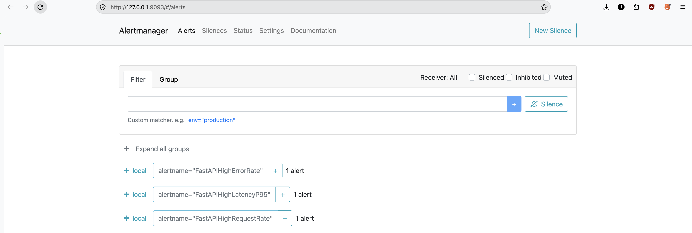

*Рисунок 28 — Полученные оповещения в Alertmanager.*

## 7.4. Настройка Webhook

Для приёма уведомлений был создан отдельный Python-сервис.

Он принимает POST-запросы от Alertmanager по адресу:

```text
http://alert-webhook:8080/alerts
```

После получения уведомления сервис выводит в Docker-логи:

- имя получателя;
- общий статус уведомления;
- список сработавших алертов.

Для проверки была повторно создана нагрузка, ошибки и задержки.

В результате webhook получил уведомления от Alertmanager со статусом `firing`.

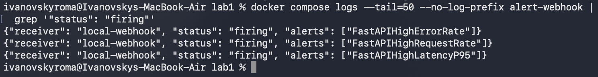

*Рисунок 29 — Успешная доставка уведомлений в Python Webhook.*

# 8. Итоги работы

В ходе лабораторной работы был создан и выжил HTTP-сервис с функционирующей системой мониторинга.

Было выполнено много задач самыми сложными для нас оказались вот эти:

- упаковать приложение в Docker-контейнер и настроить запуск инфраструктуры через Docker Compose;
- подключить Loki для хранения логов;
- настроить Grafana Alloy для сбора логов контейнера;

В целом работа не представила каких то ощутимых проблем в связи с чем мы будем питать надежду что так продолжится и дальше, хотя нельзя исключать вероятность того что нам просто повезло. Но увидите вы это чуть попозже в следующих отчетах. До новых встреч).
