# Лабораторная работа №2 — Kafka для двух сервисов от команды VGTBLS

## 1. Создание сервисов

Для начала мы создали два сервиса:

- `user-service` — создаёт заказы и отправляет их в Kafka (Producer).
- `picker-service` — получает заказы из Kafka и обрабатывает их (Consumer).

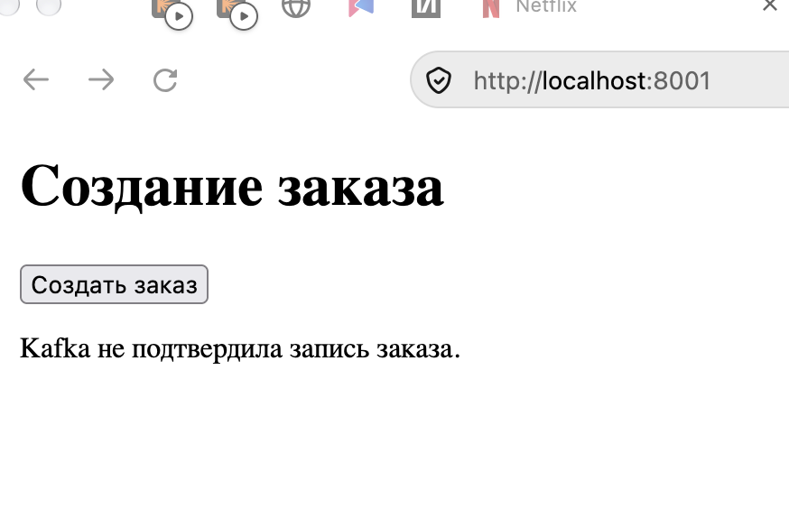

*Рисунок 1 — Интерфейс user-service.*

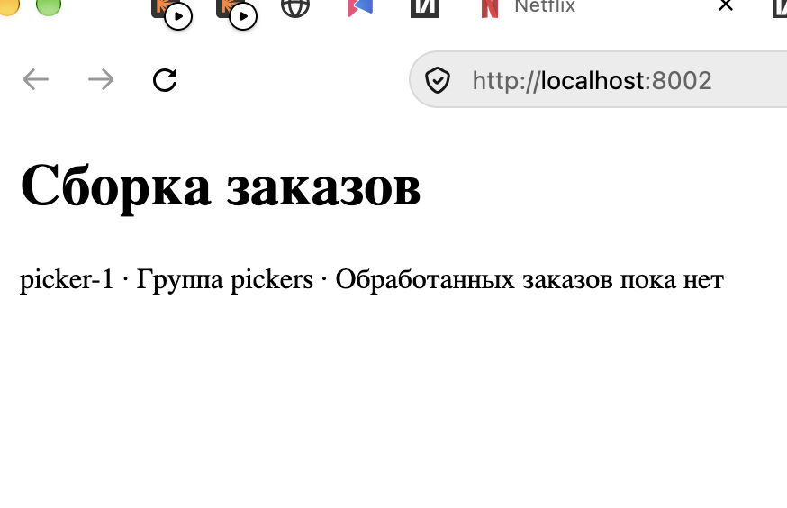

*Рисунок 2 — Интерфейс picker-service.*

Для Consumer настроили следующие параметры:

```python
{
    "group.id": "pickers",
    "auto.offset.reset": "earliest",
    "enable.auto.commit": False,
}
```

## 2. Запуск Kafka и создание топика

Для запуска проекта использовали уже знакомый нам Docker Compose:

```bash
docker compose up -d --build
docker compose ps
```

Kafka работает в режиме KRaft, без ZooKeeper.

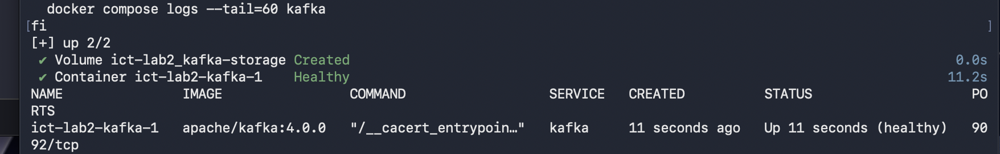

*Рисунок 3 — Запущенный брокер Kafka.*

Для создания топика `orders` использовали отдельный скрипт `kafka/init_topic.py`.

В итоге получили это:

| Параметр | Значение |
|---|---|
| Топик | `orders` |
| Партиции | 3 |
| Replication factor | 1 |
| Retention | 7 дней |

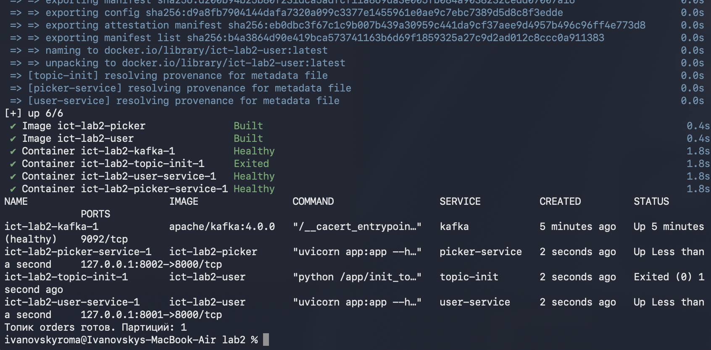

*Рисунок 4 — Создание топика orders.*

После этого создали тестовый заказ и проверили его получение сборщиком.

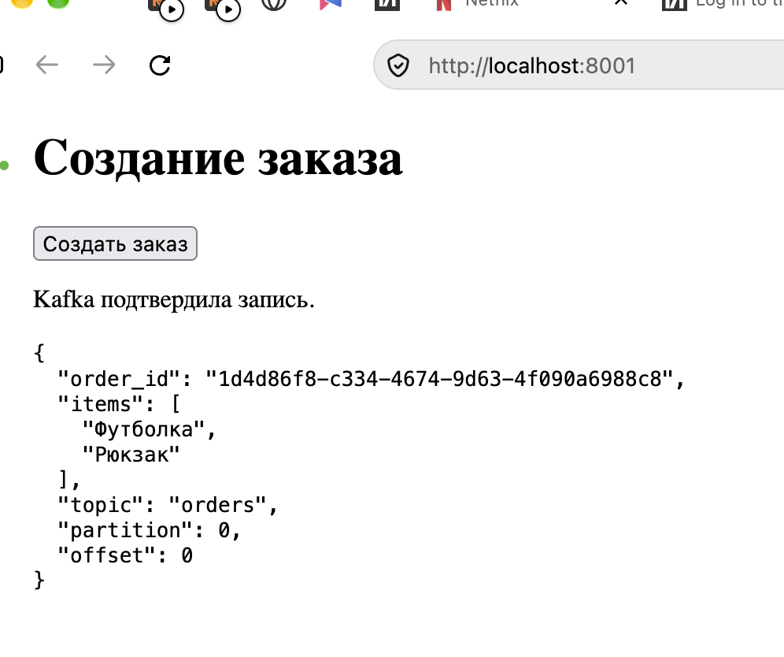

*Рисунок 5 — Отправка заказа в Kafka.*

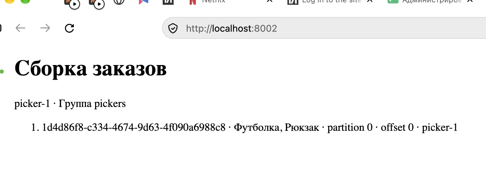

*Рисунок 6 — Получение заказа сборщиком.*

Все норм идем дальше.

## 3. Проверка партиций и масштабирования

Мы увеличили количество партиций топика `orders` до трёх и запустили несколько экземпляров `picker-service`.

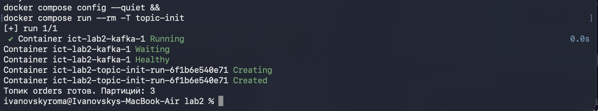

*Рисунок 7 — Три партиции топика orders.*

Затем создали новые заказы и проверили их распределение между сборщиками.

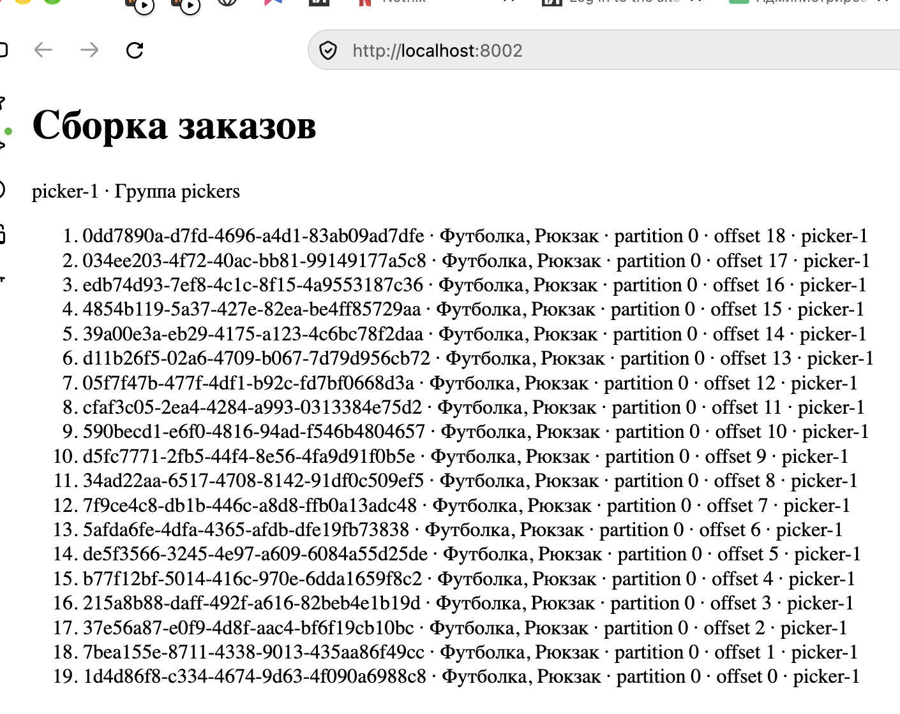

*Рисунок 8 — Работа первого сборщика.*

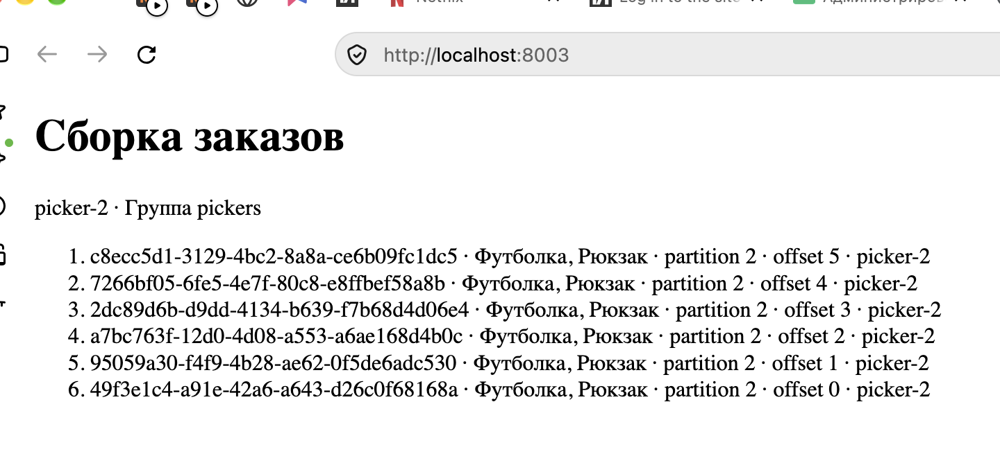

*Рисунок 9 — Работа второго сборщика.*
>[!WARNING]
>Тут был элемент мистики picker 2 отказался видеть заказы но после перепроверки и отправки новых все заработало 

Также запустили четыре сборщика при наличии трёх партиций. Один из них остался без назначенной партиции что нам и надо ведь ограничение 3.

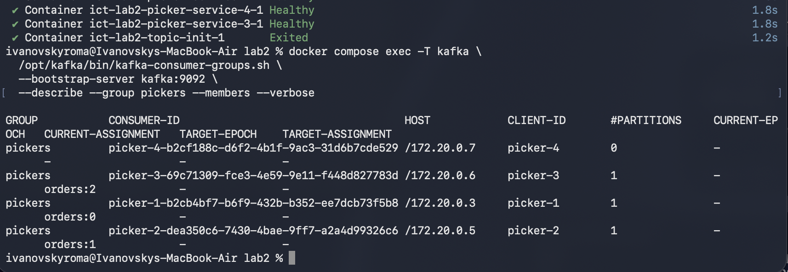

*Рисунок 10 — Один сборщик не получил партицию.*

Таким образом, мы убедились, что количество одновременно работающих потребителей одной группы ограничено количеством партиций.

## 4. Проверка остановки и восстановления сборщика

Остановили `picker-service` и отправили три новых заказа через `user-service`.

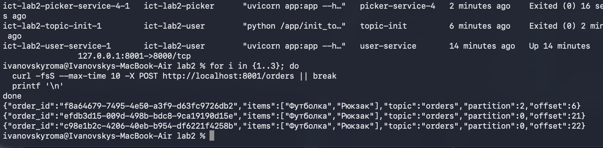

*Рисунок 11 — Отправка заказов при остановленном сборщике.*

Затем снова запустили сборщик. Он получил накопившиеся сообщения и обработал заказы.

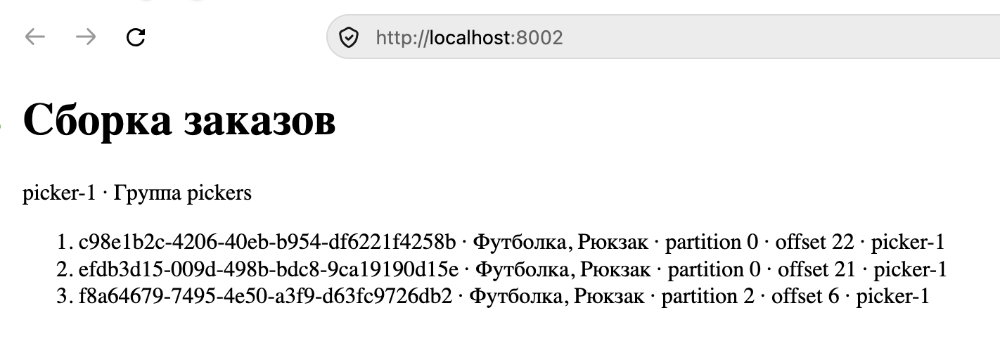

*Рисунок 12 — Обработка заказов после перезапуска.*

Мы убедились, что Kafka сохраняет сообщения, пока Consumer отдыхает.

## 5. Работа с Kafka UI

Для просмотра топиков, сообщений и потребителей использовали Kafka UI.

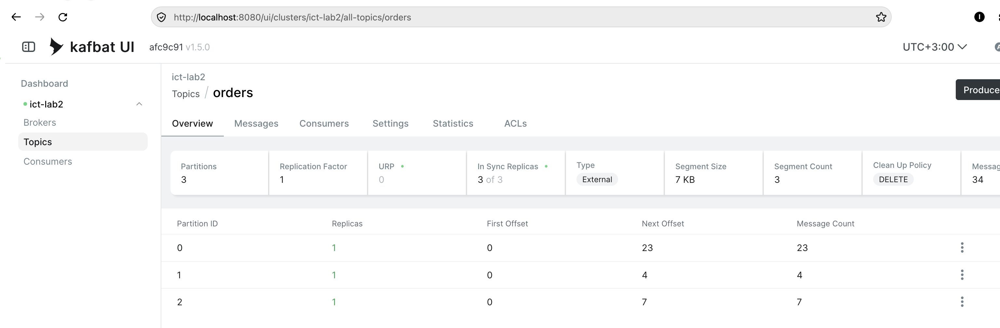

*Рисунок 13 — Просмотр топика orders.*

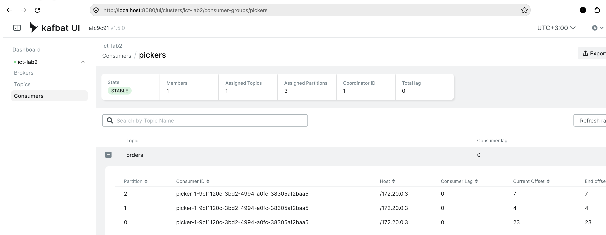

*Рисунок 14 — Consumer group pickers.*

Затем нашли конкретный заказ и проверили его позицию.

- Partition: `0`
- Offset сообщения: `22`
- Current Offset группы: `23`

Это означает, что группа уже прошла сообщение с offset 22.

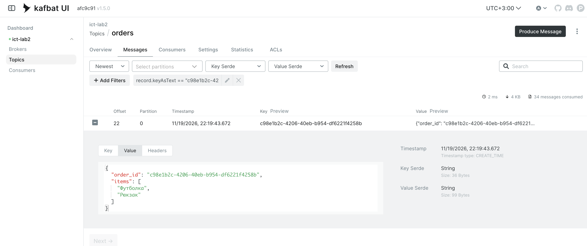

*Рисунок 15 — Поиск заказа.*

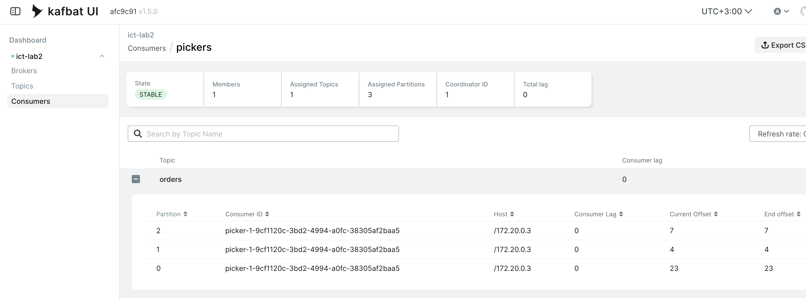

*Рисунок 16 — Проверка offset.*

## 6. Повторное чтение сообщений

Мы остановили сборщик и через Kafka UI сбросили offsets группы `pickers` на `Earliest`.

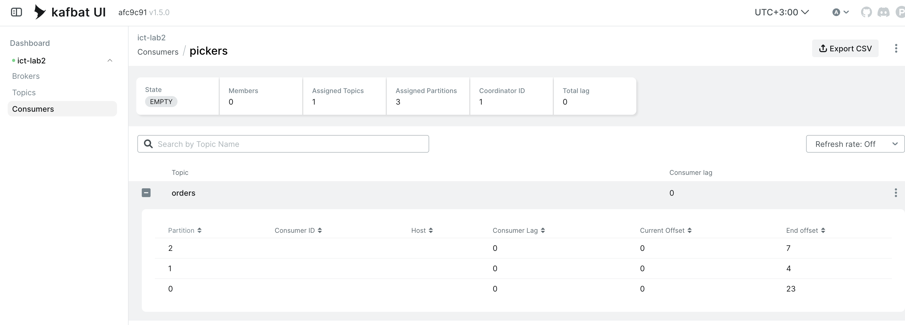

*Рисунок 17 — Сброс offsets.*

После повторного запуска сборщик заново обработал 34 заказа.

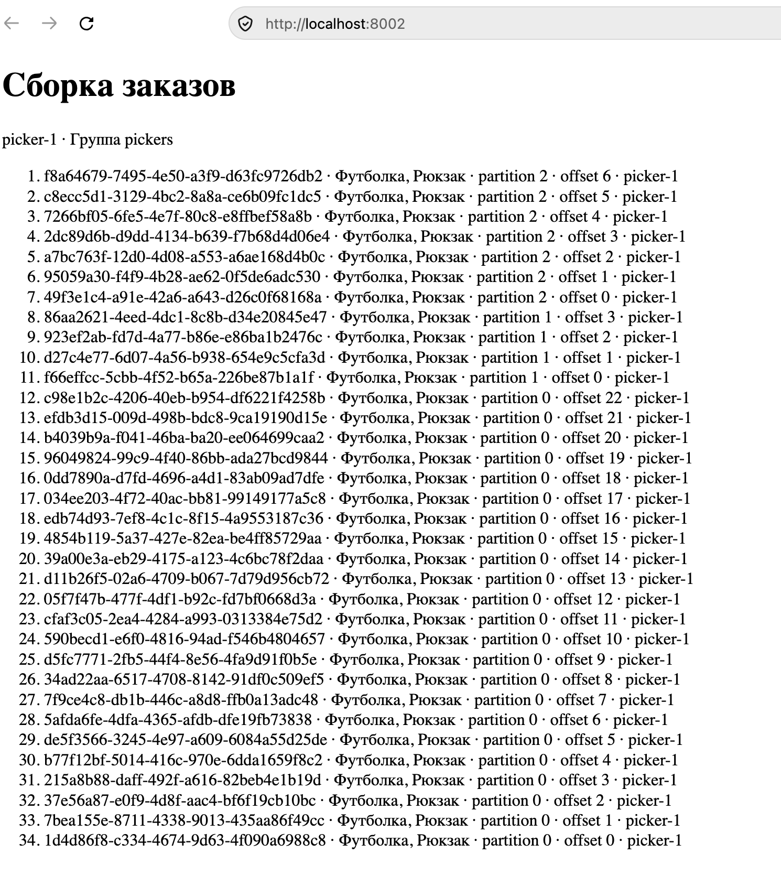

*Рисунок 18 — Повторная обработка сообщений.*

Это значит, что сообщения можно повторно читать без повторной отправки.

## 7. Проверка времени хранения сообщений

Изначально параметр `retention.ms` составлял 604800000 миллисекунд (7 дней).

Для проверки мы временно изменили его на 120000 миллисекунд (2 минуты).

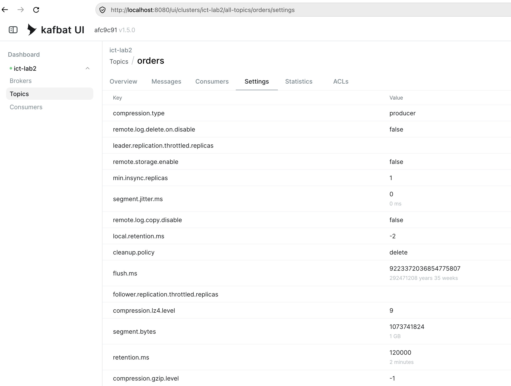

*Рисунок 19 — Изменение времени хранения.*

Создали контрольный заказ и проверили его наличие в топике.

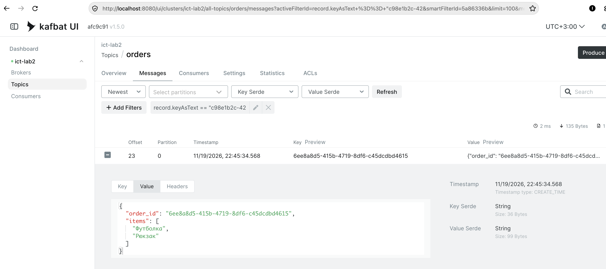

*Рисунок 20 — Сообщение до истечения срока хранения.*

После ожидания проверили состояние партиции: First Offset стал равен 24, а контрольное сообщение имело offset 23.

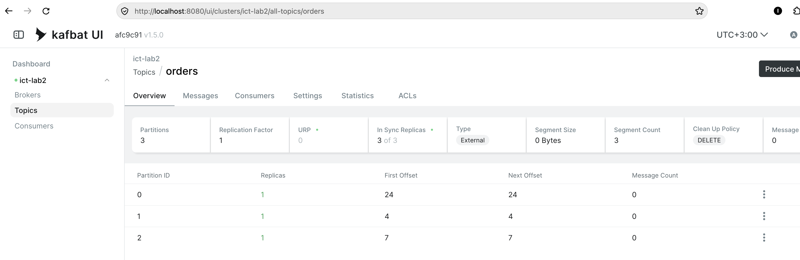

*Рисунок 21 — Удаление старого сообщения.*

После проверки вернули исходное значение `retention.ms`.

## 8. Настройка мониторинга

Для мониторинга подключили Kafka Exporter, Prometheus и Grafana.

В Prometheus настроили сбор метрик с Kafka Exporter с интервалом 15 секунд.

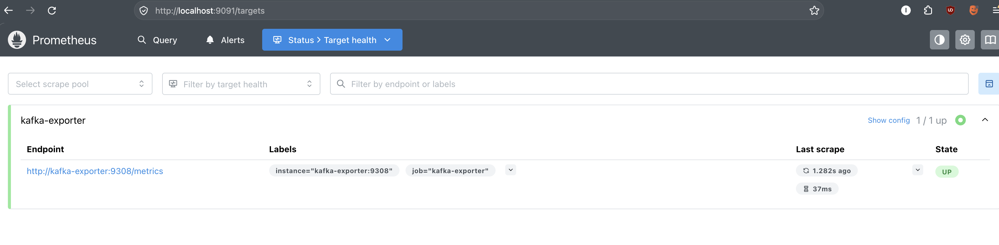

*Рисунок 22 — Kafka Exporter доступен в Prometheus.*

Проверили количество партиций с помощью запроса:

```promql
kafka_topic_partitions{topic="orders"}
```

Результат — три партиции (хороший результат, православный).

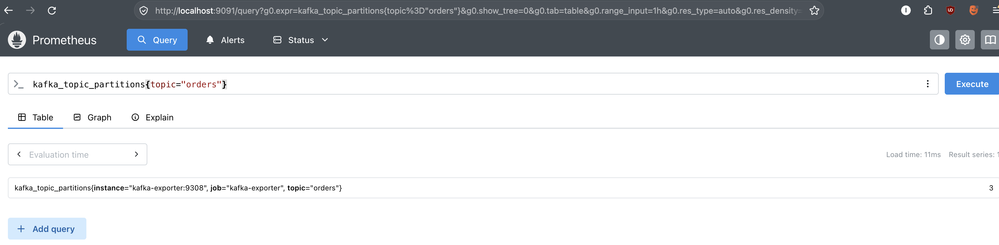

*Рисунок 23 — Проверка количества партиций.*

В Grafana настроили дашборд со следующими метриками:

**Доступность экспортёра:**

```promql
up{job="kafka-exporter"}
```

**Количество партиций:**

```promql
kafka_topic_partitions{topic="orders"}
```

**Партиции с недостаточной репликацией:**

```promql
sum(kafka_topic_partition_under_replicated_partition{topic="orders"})
```

**Отставание потребителей:**

```promql
kafka_consumergroup_lag_sum{consumergroup="pickers",topic="orders"}
```

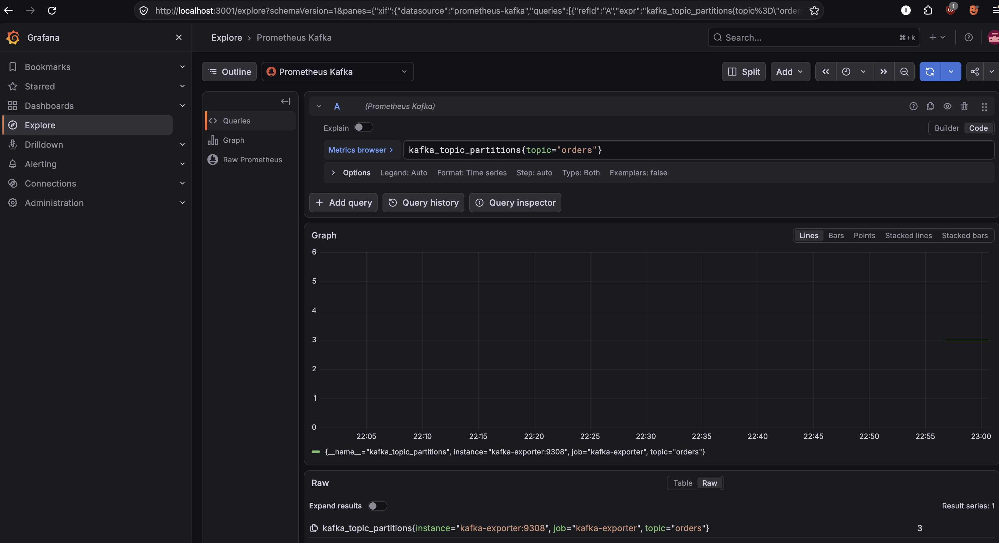

*Рисунок 24 — Проверка запросов в Grafana.*

После этого открыли готовый, красивый дашборд.

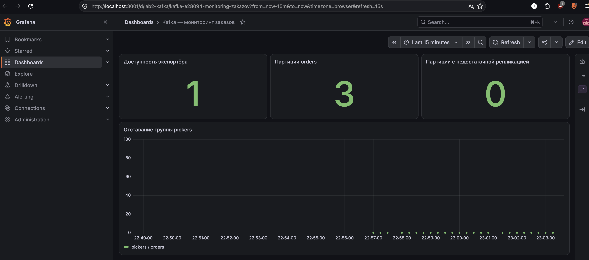

*Рисунок 25 — Дашборд мониторинга Kafka.*

### Проверка Consumer Lag

Остановили сборщик и отправили 20 заказов. Consumer Lag увеличился с 0 до 20.

После запуска сборщика все сообщения были обработаны, а lag вернулся к 0.

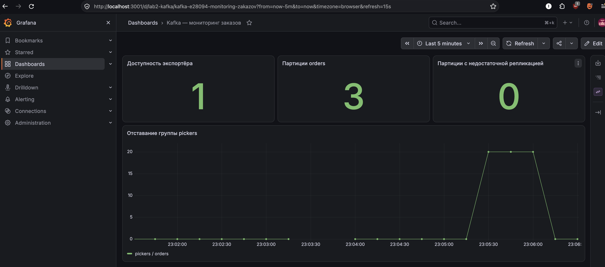

*Рисунок 26 — Изменение Consumer Lag.*

## 9. Заключение

Работа показалась не сильно сложнее предыдущей за исключением нескольких лаг моментов. В целом уже поинтереснее. Надеемся что так и будет продолжаться.
