# Лабораторная работа № 3. Репликация PostgreSQL

## Цель работы

В этой работе надо бы настроить репликацию PostgreSQL, а также подключить к базе небольшой сервис заказов и проверить, как система ведёт себя при отставании реплики и отказе основного сервера.

## 1. Настройка PostgreSQL и репликации

Сначала мы развернули окружение с помощью знакомого нам Docker Compose. В нём впахивают два сервера PostgreSQL 16:

- `primary` — основной сервер, в который приложение записывает новые данные;
- `standby` — резервный сервер, который получает изменения от основного и используется для чтения.

Для передачи изменений мы настроили физическую асинхронную потоковую репликацию. На основном сервере создали отдельную роль с правами репликации и разрешили ей подключаться к базе. Для резервного сервера подготовили первоначальную копию данных с помощью `pg_basebackup`. После запуска standby начал получать изменения из WAL — журнала операций PostgreSQL.

Пароли вынесли в локальный файл `.env`, который предусмотрительно не добавляли в репозиторий.

После запуска мы проверили состояние контейнеров и соединение между серверами. В выводе PostgreSQL увидели состояние `streaming` и режим `async`. Также создали тестовую запись и проверили, что она появилась на обоих узлах. Дополнительная проверка `pg_is_in_recovery()` на резервном сервере вернула `true`, значит все правильно.

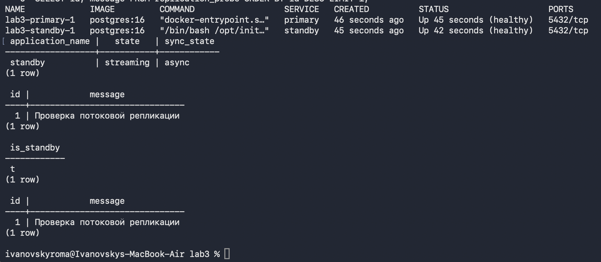

*Рисунок 1 — Оба контейнера работают, реплика подключена к основному серверу, тестовая запись доступна на обоих узлах.*

## 2. Подключение сервиса заказов

Далее мы добавили небольшое приложение на Python с использованием FastAPI. Через него можно создавать заказы и просматривать последние записи в базе.

В приложении разделили адреса для чтения и записи:

- `WRITE_DB_HOST` указывает на основной сервер;
- `READ_DB_HOST` указывает на резервный сервер.

Поэтому при создании заказа приложение обращается к primary, а при просмотре списка заказов — к standby. Для проверки мы открыли приложение в браузере по адресу `http://127.0.0.1:8080`.

Сначала создали один заказ. Он получил номер `#1` и отобразился в списке, который приложение прочитало с реплики. Затем нажали кнопку массовой загрузки и добавили ещё тыщу заказов. Последний из них получил номер `#1001 и появился на резервном сервере.

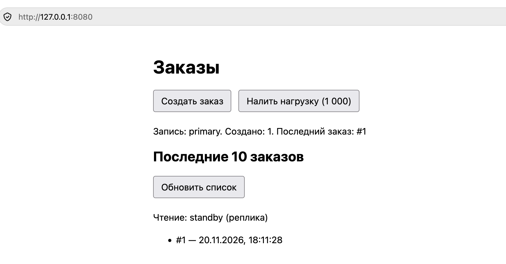

*Рисунок 2 — Первый заказ записан на primary и отображается при чтении со standby.*

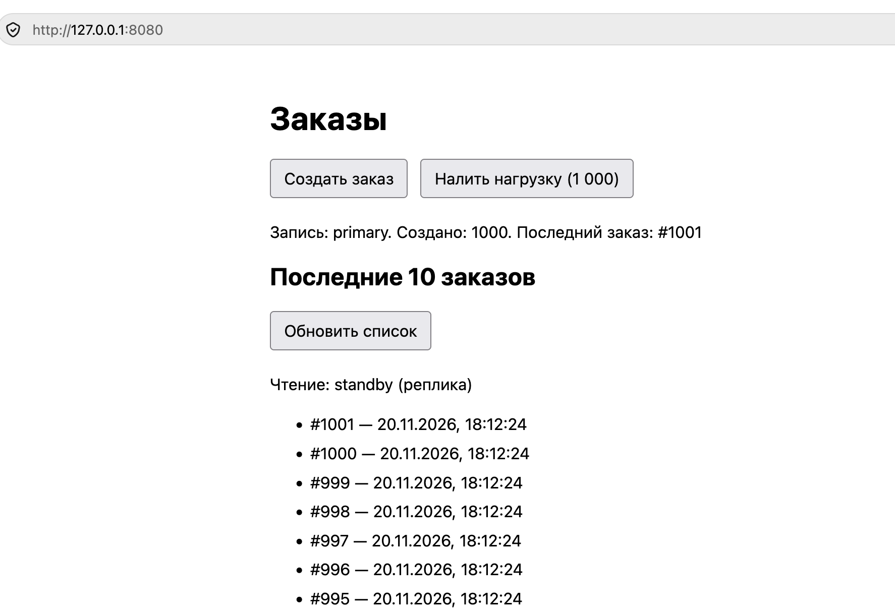

*Рисунок 3 — После добавления 1 000 заказов последний заказ имеет номер #1001 и виден на реплике.*

## 3. Проверка отставания реплики

Затем мы проверили, что произойдёт, если резервный сервер не будет успевать применять изменения.

Для этого на standby временно приостановили именно применение WAL-записей. При этом реплика продолжала получать WAL от основного сервера и отвечать на запросы чтения.

После паузы мы снова добавили 1 000 заказов. Основной сервер создал заказ `#2001`, но при обновлении списка приложение всё ещё показывало старые данные: на реплике последним оставался заказ `#1001`.

Чтобы измерить отставание, мы сравнили позицию последнего полученного WAL с позицией последнего применённого WAL. Разница составила **161 808 байт**. В выводе также было видно состояние `paused`.

После измерения мы возобновили применение WAL и обновили список заказов. Реплика догнала основной сервер, и заказ `#2001` появился в выдаче. Все штатно.

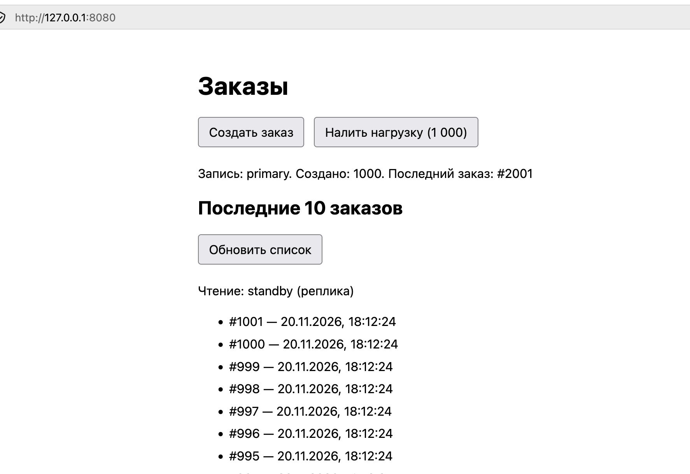

*Рисунок 4 — На основном сервере уже создан заказ #2001, но список на реплике ещё содержит предыдущие данные.*

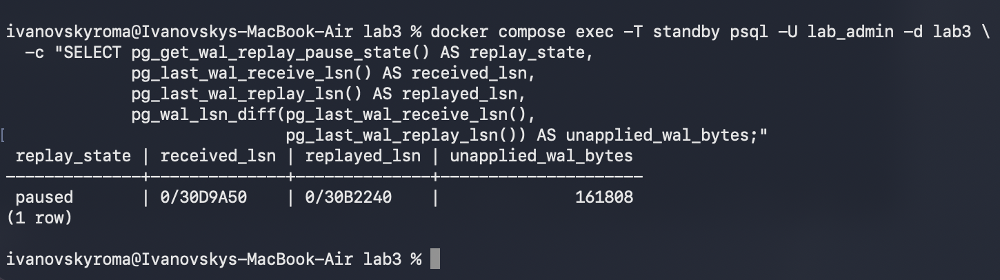

*Рисунок 5 — Применение WAL приостановлено; разница между полученной и применённой позициями составляет 161 808 байт.*

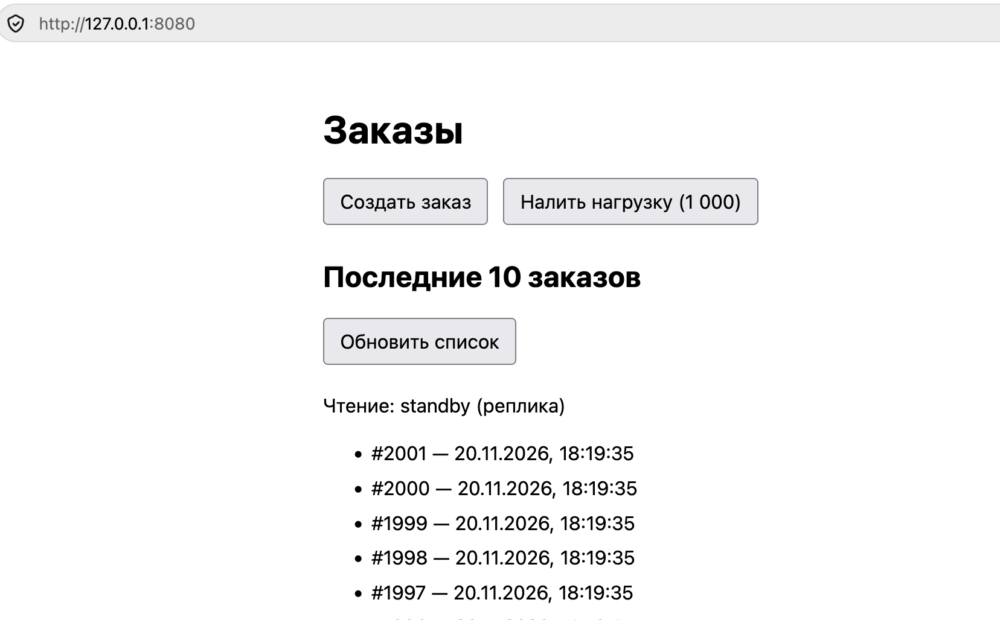

*Рисунок 6 — После возобновления применения WAL заказ #2001 появился в списке на standby.*

Этот эксперимент показал особенность асинхронной репликации: основной сервер может подтвердить запись раньше, чем резервный сервер применит её. Поэтому чтение с реплики иногда возвращает немного устаревшие данные.

## 4. Отказ основного сервера и переключение на резервный

На следующем этапе мы проверили отказ основного сервера. Для этого остановили контейнер `primary` и попробовали создать новый заказ через приложение.

Запись завершилась ошибкой, потому что основной сервер собственно больше не принимал подключения. При этом чтение продолжало работать: приложение всё ещё могло получить список заказов с резервного сервера.

После этого мы вручную повысили standby до основного узла с помощью функции PostgreSQL `pg_promote()`. Затем проверили его роль через `pg_is_in_recovery()`: после повышения сервер уже не находился в режиме восстановления.

Мы изменили настройки приложения так, чтобы оно использовало бывший standby и для чтения, и для записи. Старый primary оставили остановленным, чтобы два сервера одновременно не работали как основные. После переключения снова создали заказ. Операция прошла успешно, новый заказ получил номер `#2025`.

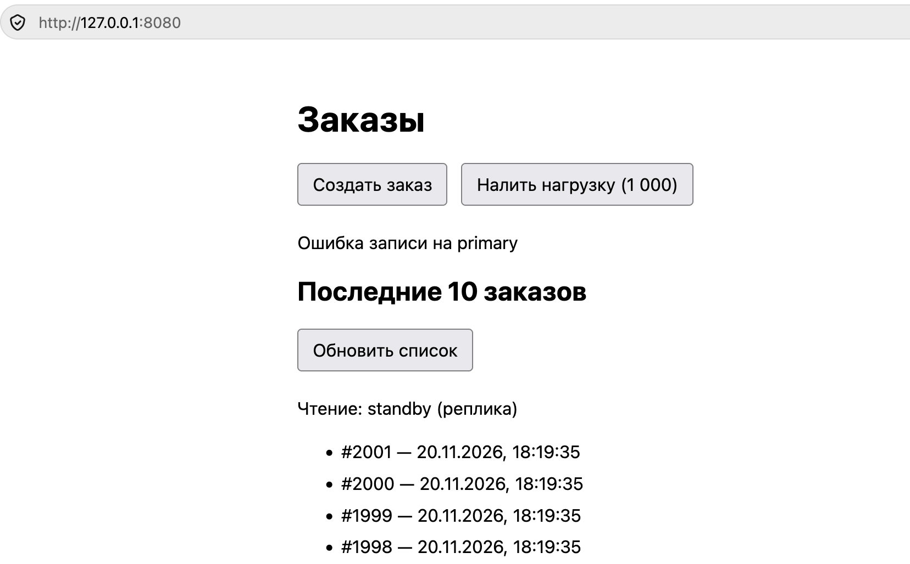

*Рисунок 7 — Основной сервер остановлен: создать заказ не получается, но чтение со standby продолжает работать.*

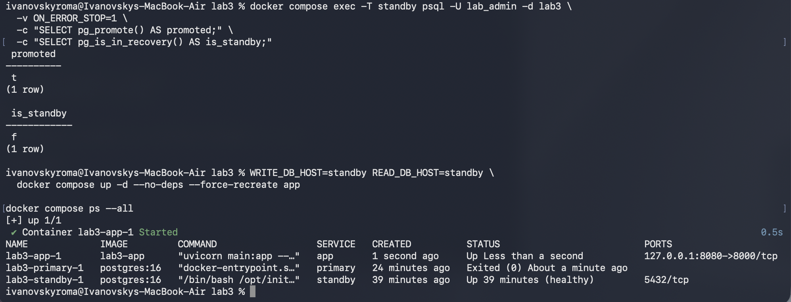

*Рисунок 8 — Резервный сервер повышен до основного.*

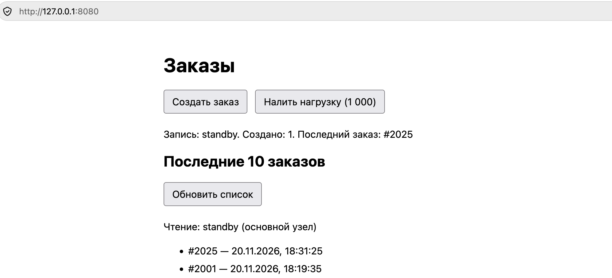

*Рисунок 9 — После изменения настроек приложения заказ #2025 успешно создан на новом основном сервере.*

Переключение сейчас мы выполняли вручную. Это позволило проверить сам принцип failover, но автоматическое обнаружение отказа и переключение мы не настраивали.

## 5. Восстановление репликации и настройка мониторинга

После переключения бывший standby стал основным сервером, поэтому для восстановления резервирования мы подготовили новый узел — `rejoined`.

Новый контейнер получил отдельное хранилище данных и первоначальную копию базы с нового primary. Затем мы подключили его к потоковой репликации. Старый primary оставили выключенным.

После запуска проверили состояние соединения: новый резервный сервер находился в режиме `streaming / async`. Дополнительно убедились, что на нём доступен заказ `#2025`.

Затем мы настроили мониторинг. Для сбора метрик PostgreSQL использовали PostgreSQL Exporter, для получения и проверки показателей — Prometheus, а для отображения графиков — Grafana.

В Prometheus добавили две цели: для основного и резервного узлов. На странице Targets обе цели отображались как доступные — `2 / 2 up`.

В Grafana подготовили дашборд с четырьмя панелями:

1. доступность PostgreSQL;
2. роль каждого узла;
3. отставание реплики по WAL;
4. количество подключений к базе `lab3`.

На момент проверки реплика догнала основной сервер, поэтому отставание на графике было равно нулю.

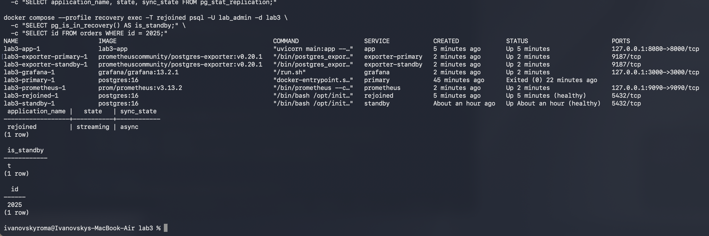

*Рисунок 10 — Новый резервный сервер подключён к основному, состояние репликации — streaming / async.*

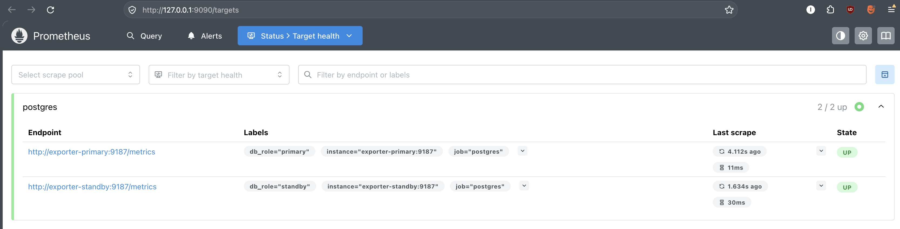

*Рисунок 11 — Prometheus получает метрики от обоих экспортёров: обе цели доступны.*

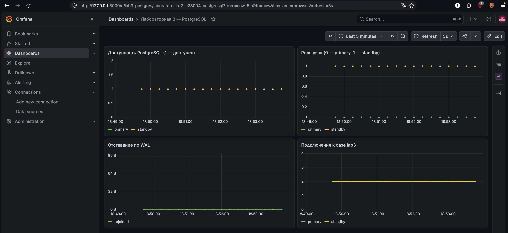

*Рисунок 12 — Дашборд Grafana с показателями доступности, ролей узлов, отставания по WAL и подключений к базе.*

## 6. Проверка оповещений

В завершение мы решили добавить в Prometheus три правила оповещений:

- `PostgreSQLUnavailable` — срабатывает, если база или её экспортёр становятся недоступны;
- `PostgreSQLReplicationLagHigh` — предупреждает, если отставание реплики превышает установленный порог **65 536 байт**;
- `PostgreSQLStandbyNotStreaming` — показывает, что резервный сервер перестал получать потоковые изменения от основного.

Для проверки первого сценария мы снова приостановили применение WAL и создали дополнительную нагрузку. После превышения заданного порога Prometheus перевёл правило отставания в состояние `Firing`.

Затем остановили резервный сервер. В этот момент сработали предупреждения о недоступности PostgreSQL и о прекращении потоковой репликации.

После проверки мы запустили резервный сервер обратно и убедились, что соединение восстановилось. В Prometheus все три правила вернулись в состояние `Inactive`.

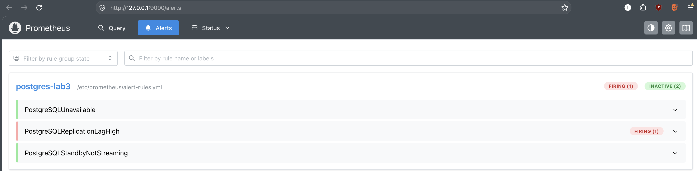

*Рисунок 13 — Правило PostgreSQLReplicationLagHigh перешло в состояние Firing.*

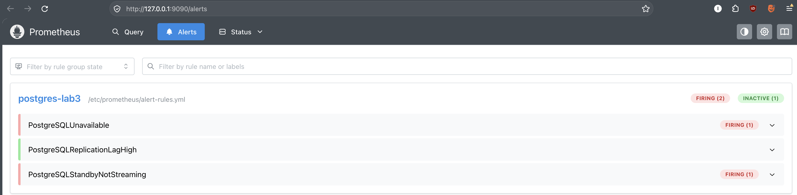

*Рисунок 14 — После остановки резервного узла сработали предупреждения о недоступности и прекращении репликации.*

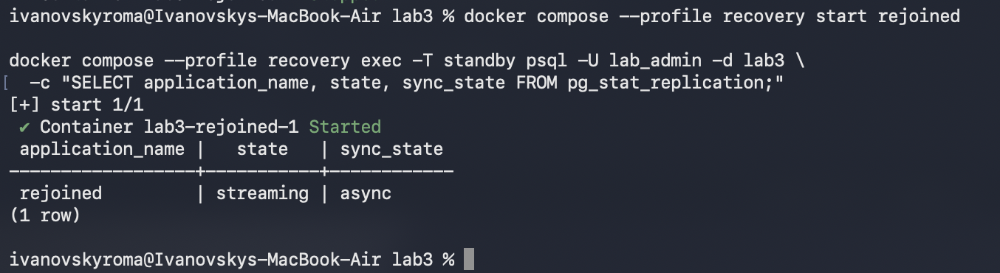

*Рисунок 15 — После запуска резервного узла снова отображается состояние streaming / async.*

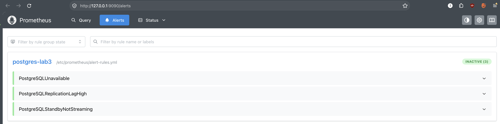

*Рисунок 16 — После восстановления системы все три правила находятся в состоянии Inactive.*

## Заключение

Собственно эта работа показалась ваще пока самой простой, что не сильно логично вроде. Достаточно представлять себе как примерно работают бд и все остальное будет работать. Но наша команда продолжает верить, что нас настигнет правосудие тяжелых лабораторных. 
