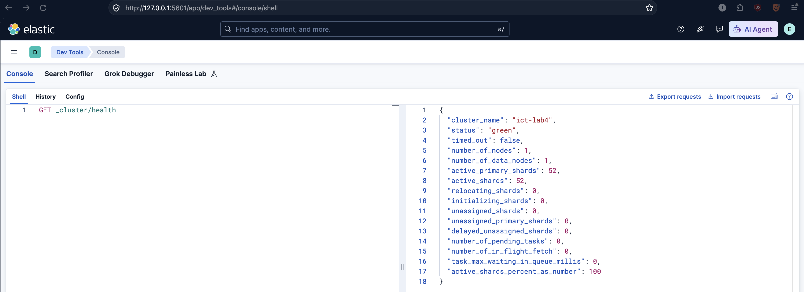
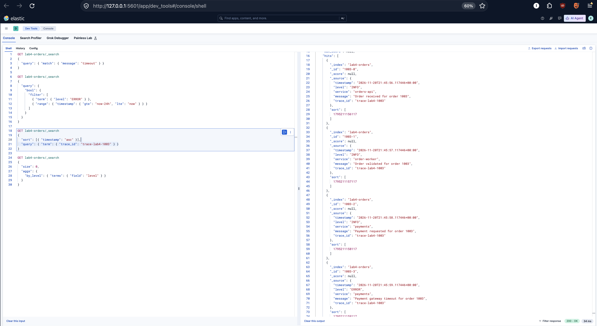
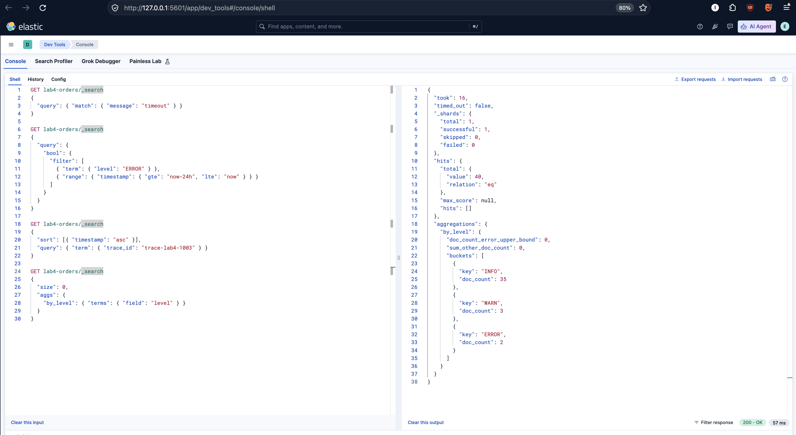
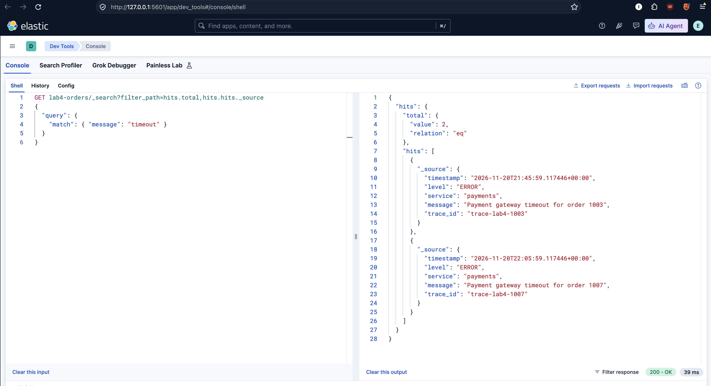
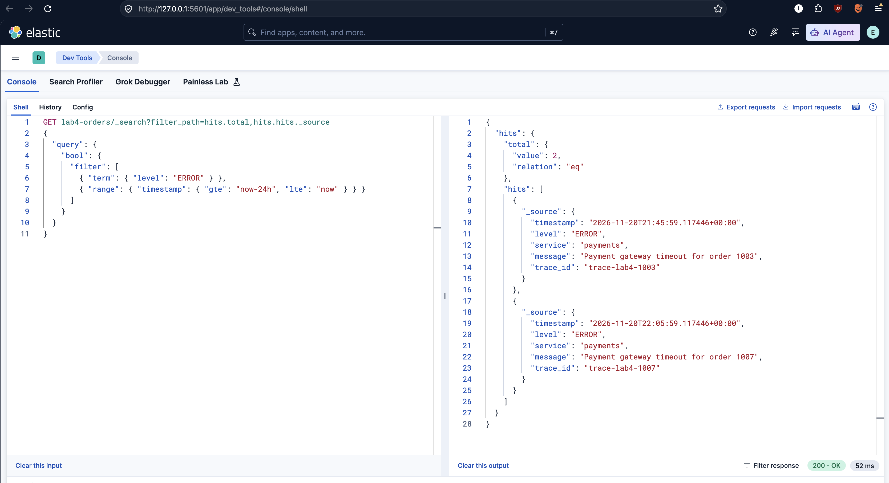
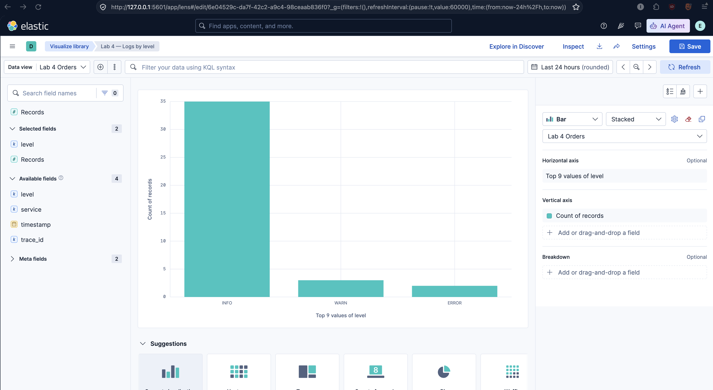
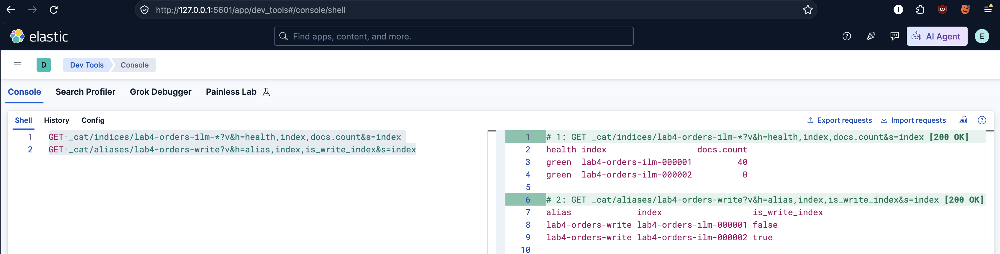
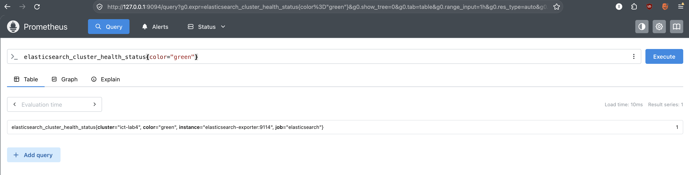
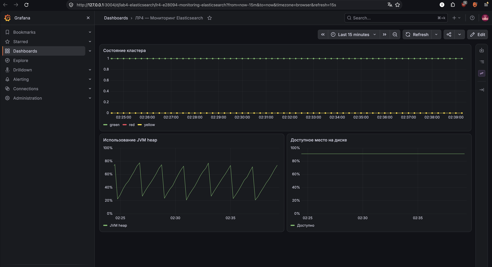

# Лабораторная работа № 4. Elasticsearch, Kibana и мониторинг

## Цель работы

Собсна требуется развернуть Elasticsearch и Kibana, плюс научиться загружать и искать записи журналов, создавать графики и настраивать мониторинг системы.

## 1. Запуск Elasticsearch и Kibana

Для начала мы готовим старый добрый Docker Compose и запускаем Elasticsearch и Kibana.

Elasticsearch использовали для хранения и поиска записей, а Kibana — для просмотра данных через браузер.

Для проверки выполнили базовый запрос:

```http
GET _cluster/health
```

В результате получили статус `green`. Это означает, что все необходимые части данных доступны. Мы использовали один узел и отключили реплики.



## 2. Создание индекса и загрузка данных

Далее мы создали индекс `lab4-orders` и загрузили в него аж 40 тестовых записей о работе заказов.

Для создания записей использовали Python-скрипт `generate_logs.py`. Каждая запись содержит время, уровень сообщения, название сервиса, текст сообщения и идентификатор операции.

После загрузки проверили поиск сообщений, поиск ошибок, поиск событий конкретного заказа и подсчёт записей по уровням.

В результате получили:
- INFO — 35 записей;
- WARN — 3 записи;
- ERROR — 2 записи.





Также выполнили поиск сообщений со словом `timeout`. В результате кое че нашлось .



Отдельно проверили поиск ошибок уровня ERROR за последние 24 часа. Результат составил две записи.



## 3. Создание графика в Kibana

После проверки запросов мы перешли в Kibana и создали диаграмму с помощью Lens.

Для этого выбрали созданный индекс и настроили отображение количества сообщений по их уровням.

На графике отображаются как раз три категории: INFO, WARN и ERROR.



## 4. Настройка автоматической смены индексов

Следующим этапом мы настроили автоматическую смену индексов с помощью ILM.

Создали правило, по которому индекс меняется после достижения 40 записей или одного дня работы. Также предусмотрели удаление старого индекса через 10 минут после смены.

Для этого создали шаблон индекса и alias, через который выполняется запись данных.

После проверки увидели, что старый индекс содержит 40 записей, а новый создан автоматически и используется для дальнейшей записи.



## 5. Настройка мониторинга

Для мониторинга мы подключили Elasticsearch Exporter, Prometheus и Grafana.

Elasticsearch Exporter собирает информацию о состоянии Elasticsearch и передаёт её в Prometheus. Grafana использует эти данные для построения графиков.

После запуска проверили, что Prometheus точно получает информацию о состоянии кластера.



## 6. Создание дашборда Grafana

После настройки мониторинга мы создали dashборд снова в Grafana.

На нём разместили три графика:

1. Состояние кластера.
2. Использование памяти JVM.
3. Свободное место на диске.

Графики позволяют следить за состоянием системы и вовремя замечать возможные проблемы.



### Какие показатели важно контролировать

Мы выделили три основных показателя:

- **Состояние кластера.** Если появляется статус RED, часть данных может стать недоступной.
- **Использование памяти JVM.** Если память долго занята более чем на 85%, система может потерять работоспособность.
- **Свободное место на диске.** Если остаётся меньше 15%, может возникнуть нехватка места.

Эти показатели помогают заранее замечать проблемы и принимать меры.

## 7. Результат работы
Здесь вроде как все знакомо уже, но тем не менее вышло почему то муторнее чем предыдущие. Тем не менее серьезных проблем по ощущениям все еще не было предоствлено.
