# Лабораторная работа № 5. Внутренний GitLab, единый вход, nginx и раннеры

## Цель работы

А вот и она - работа потратившая кучу времени и сил. Мы дошли до нее.

Итак список того что надо: развернуть собственный GitLab, настроить единый вход через Keycloak, организовать доступ через nginx потом подключить два типа GitLab Runner и настроить автоматическую сборку приложения. Дополнительно настроить мониторинг nginx с помощью Prometheus и Grafana.

В общем дел куча.

## 1. Подготовка стенда

Для выполнения работы мы использовали Docker. Опять.

В Docker Compose подготовили GitLab, Keycloak, nginx, Grafana, Prometheus и GitLab Runner. Дополнительно создали Kubernetes-кластер с помощью kind.

Основные адреса проживающих:

| Адрес | Назначение |
|---|---|
| `http://keycloak.local:8080` | Keycloak |
| `https://gitlab.local` | GitLab |
| `https://registry.gitlab.local` | Container Registry |
| `http://grafana.local:3000` | Grafana |
| `http://localhost:9090` | Prometheus |

## 2. Настройка единого входа через Keycloak

Сначала мы настроили Keycloak для централизованной авторизации.

Создали realm `devplatform`, добавили клиентов `gitlab` и `grafana`, а также пользователя `labuser`.

После этого подключили GitLab и Grafana через OpenID Connect. Благодаря этому пользователь может входить в оба приложения с одной учётки.

Проверили настройки Keycloak и созданные клиенты.

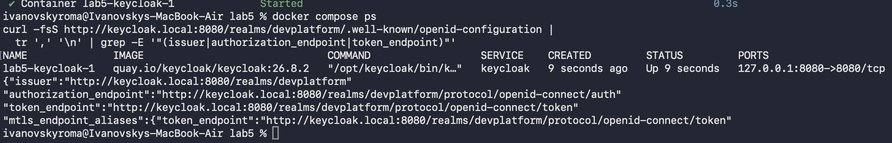

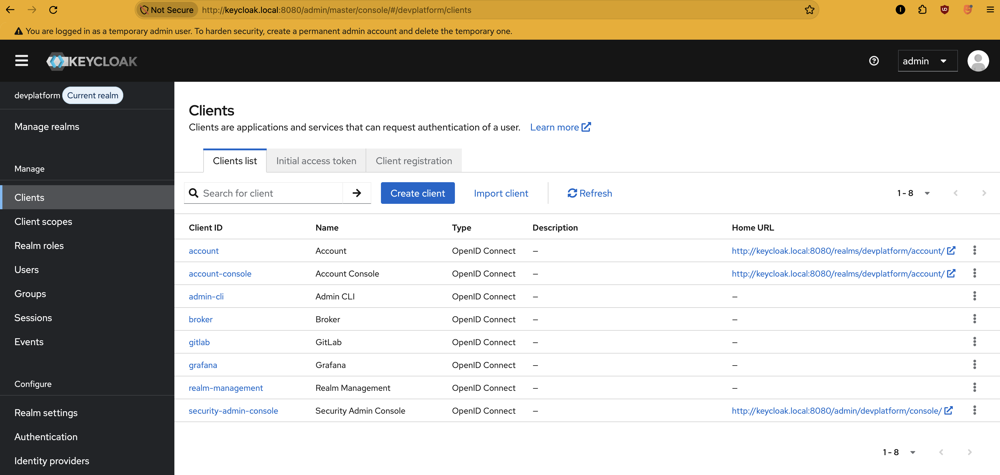

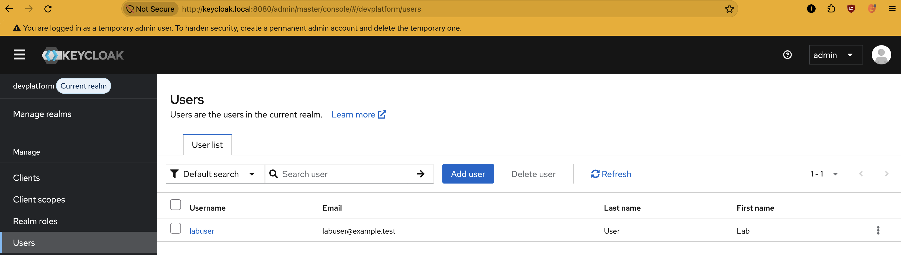

Затем проверили кнопку входа через Keycloak в GitLab.(работает)

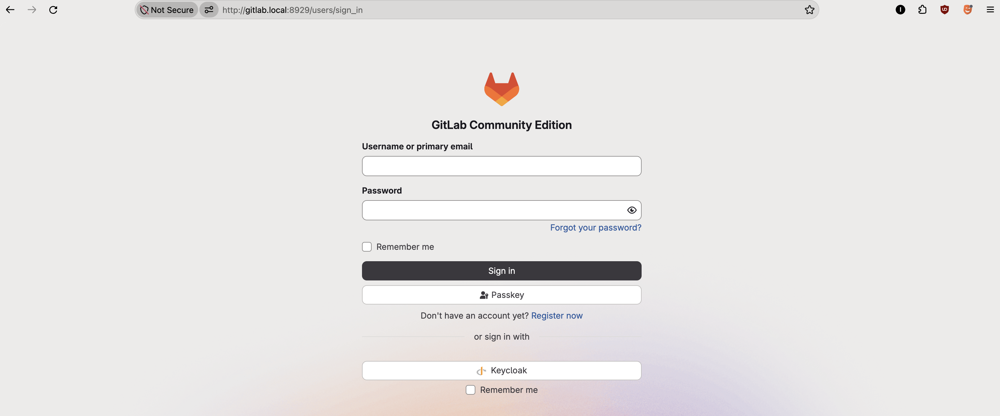

После этого выполнили вход в GitLab и Grafana под одной учётной записью.(успешно)

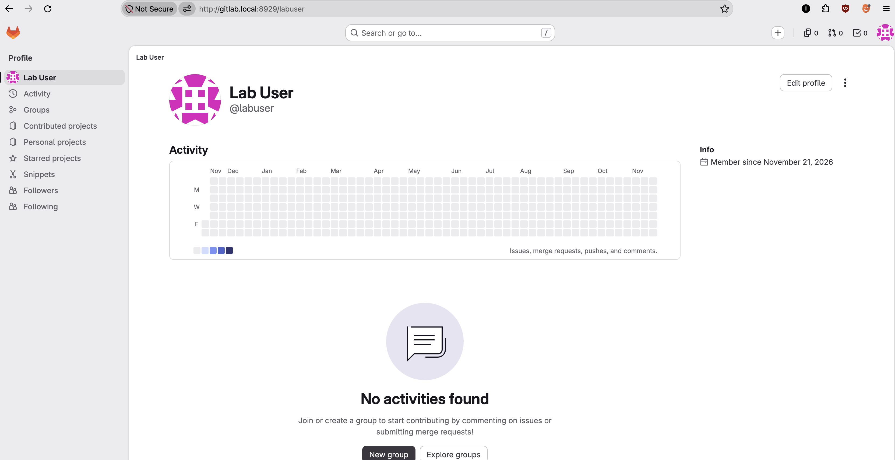

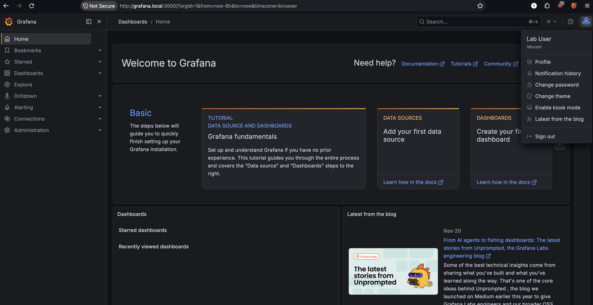

## 3. Настройка nginx и HTTPS

Далее мы настроили nginx, который принимает запросы пользователей и перенаправляет их на нужные нам сервисы.

Для GitLab и Container Registry настроили отдельные адреса и HTTPS.

Также добавили несколько правил:
- Перенаправление HTTP на HTTPS.
- Ограничение доступа к административной панели.
- Ограничение количества запросов к странице входа.
- Закрытие служебных адресов от внешнего доступа.

Для локального стенда создали самоподписанный сертификат.

Проверили перенаправление на HTTPS.

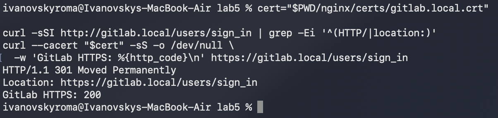

Проверили правила доступа.

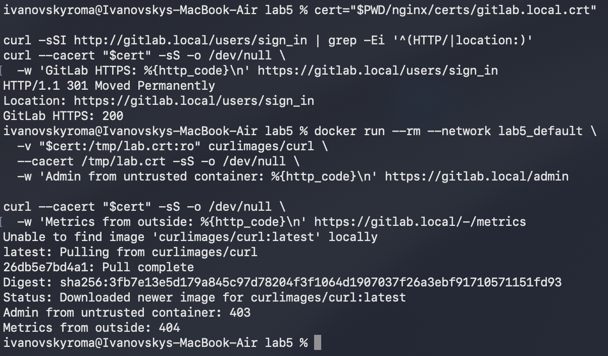

Отдельно проверили ограничение запросов. При превышении установленного лимита nginx возвращает код `429`.

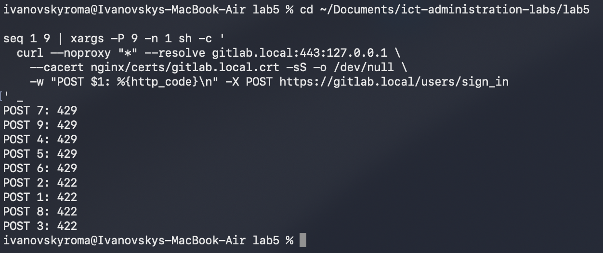

Также проверили доступ к Container Registry. Без авторизации сервер возвращает `401`.

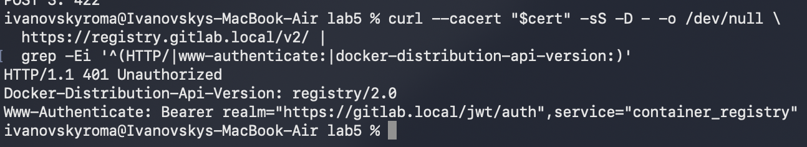

В конце повторно проверили вход в GitLab через HTTPS.

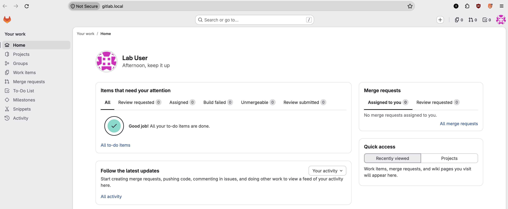

## 4. Настройка GitLab Runner

Следующим этапом мы создали приватный проект `devplatform-service` и настроили два Runner:

- `static` — обычный Docker Runner.
- `dynamic` — Kubernetes Runner.

Они нужны для автоматического выполнения проверок и сборки приложения.

Сначала проверили созданный проект.

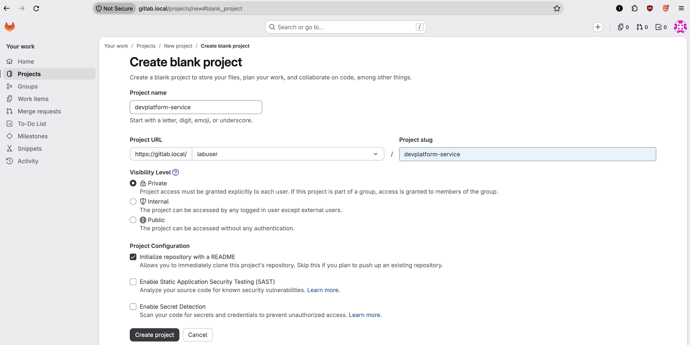

### 4.1. Docker Runner

Значится зарегистрировали обычный Docker Runner. Он работает постоянно и запускает отдельный контейнер для каждой задачи.

Проверили его состояние и запустили тестовую задачу.

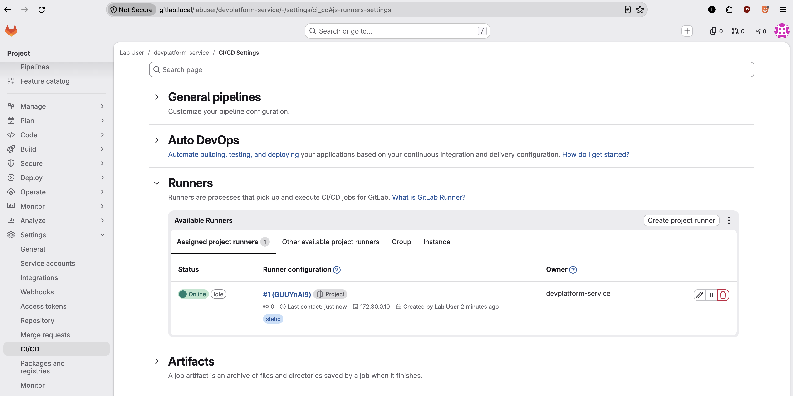

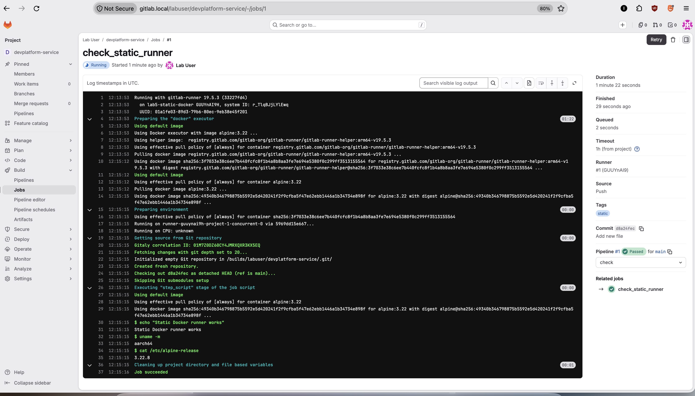

### 4.2. Kubernetes Runner

Затем создали Kubernetes-кластер с помощью kind. В нём настроили отдельное пространство для Runner.

Особенность этого варианта заключается в том, что для каждой задачи создаётся отдельный под, который удаляется после завершения работы.

Проверили состояние кластера.

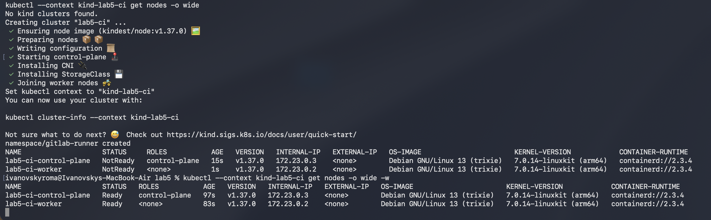

Убедились, что оба Runner доступны в GitLab.

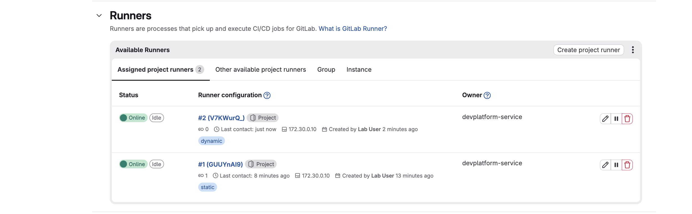

Проверили создание под и выполнение задачи.

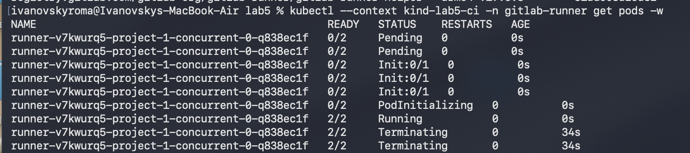

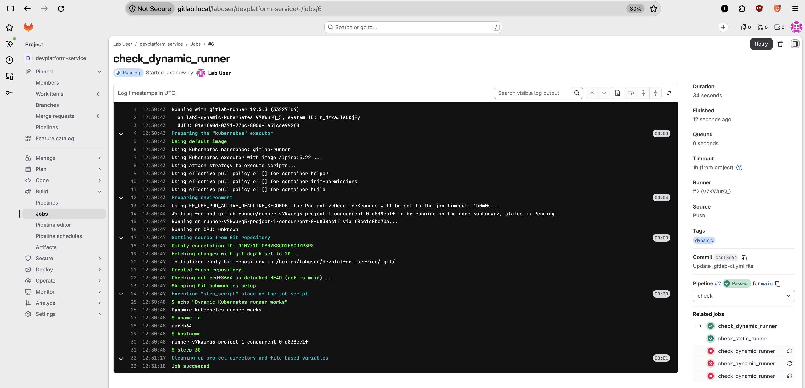

После выполнения задачи проверили удаление под.

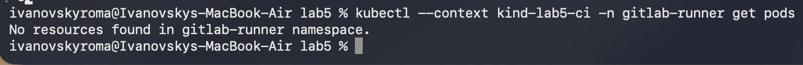

Также увеличили количество одновременно выполняемых задач до двух и проверили параллельную работу.

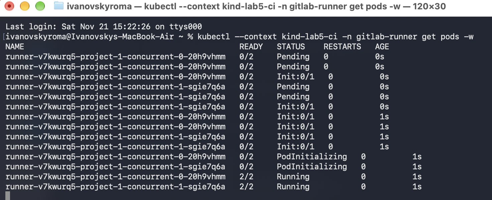

## 5. Создание приложения и настройка CI/CD

Для проверки Runner мы собрали не  без посторонней помощи небольшое приложение на Flask.

В приложении предусмотрены два адреса:
- `/` — возвращает информацию о сервисе.
- `/health` — показывает состояние приложения.

Также добавили автоматические тесты.

В файле `.gitlab-ci.yml` настроили три задачи:

| Задача | Назначение |
|---|---|
| `check_syntax` | Проверка синтаксиса Python |
| `unit_tests` | Запуск тестов приложения |
| `build_publish` | Сборка и публикация Docker-образа |

Первые две задачи запускаются параллельно на Kubernetes Runner. После успешных проверок Docker Runner собирает образ и отправляет его в Container Registry. Проверяем.

Проверили успешное выполнение тестов.

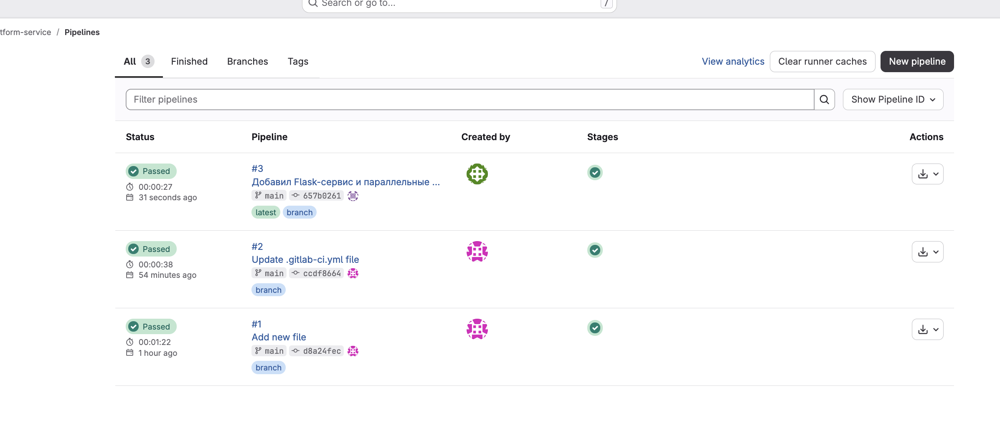

Затем проверили весь пайплайн. Пайплайн № 4 завершился успешно.

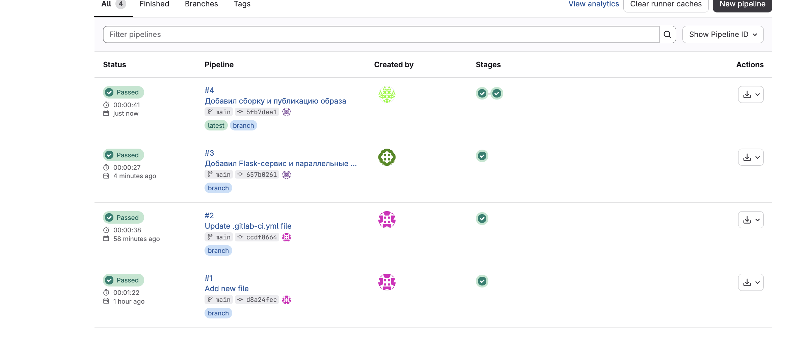

Отдельно проверили сборку и публикацию Docker-образа.

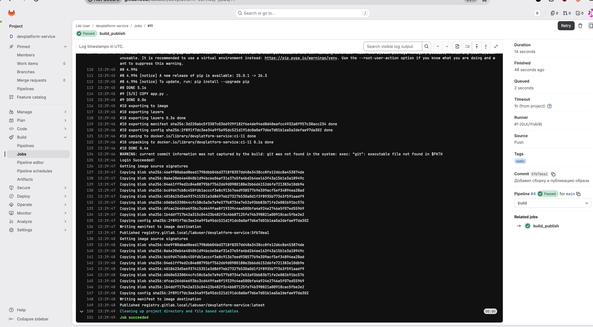

В Container Registry проверили опубликованные образы. Они получили теги `latest` и `5fb7dea1`.

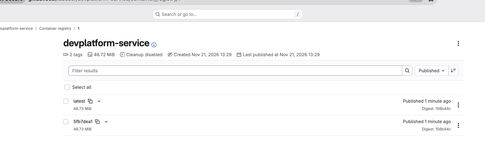

## 6. Настройка мониторинга nginx

Для мониторинга мы подключили три компонента:

- nginx Exporter — собирает показатели nginx.
- Prometheus — получает и хранит метрики.
- Grafana — отображает информацию в виде графиков.

Для начала включили `stub_status` и настроили передачу показателей через Exporter.

Проверили, что Prometheus успешно подключился к Exporter.

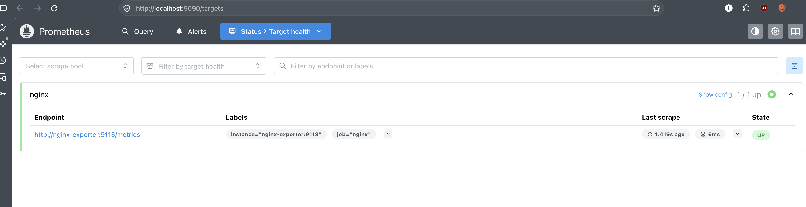

Затем проверили получение метрик nginx.

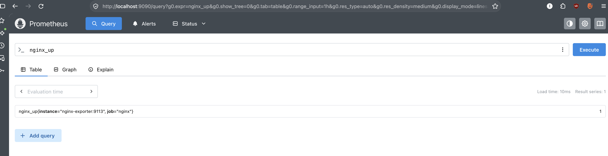

## 7. Создание дашборда Grafana

После настройки мониторинга мы создали дашборд Grafana.

На нём в этот раз разместили четыре показателя:

1. Состояние nginx.
2. Количество активных соединений.
3. Количество HTTP-запросов в секунду.
4. Разницу между принятыми и обработанными соединениями.

Данные обновляются автоматически каждые 10 секунд для удобства.

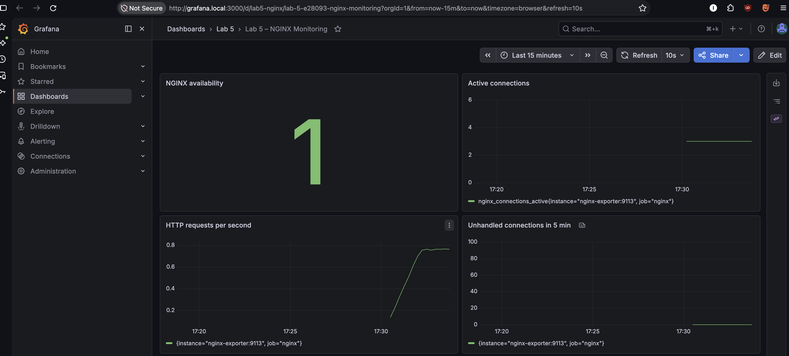

## 8. Настройка уведомлений

Дополнительно мы настроили три правила оповещений в Prometheus.

| Название | Назначение |
|---|---|
| `NginxTelemetryUnavailable` | Проверка доступности метрик |
| `NginxHighActiveConnections` | Контроль большого количества соединений |
| `NginxUnhandledConnections` | Контроль необработанных соединений |

Для проверки остановили nginx Exporter. После этого первое правило перешло в состояние `Firing`.

Затем снова запустили Exporter. Метрики восстановились, а уведомление вернулось в нормальное состояние.

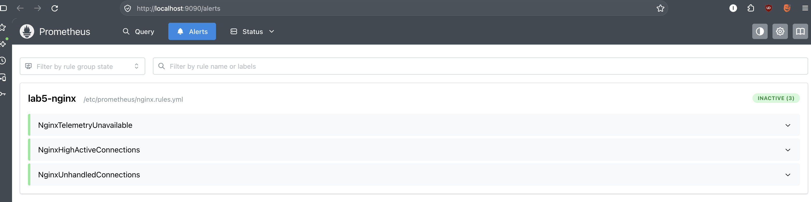

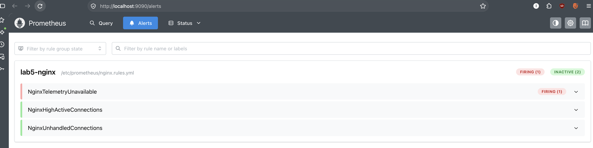

## 9. Возникшие трудности

А вот и блок достойный внимания. В данной работе все было не так просто.

Вот такую табличку приколов получилось собрать по ходу выполнения:

| Проблема | Решение |
|---|---|
| Необходимость согласовать адреса при переходе на HTTPS. | Настроили доменные имена и сертификат. |
| Не удавалось сразу проверить ограничение запросов nginx. | Выполнили параллельную отправку запросов. |
| Kubernetes Runner использовал неподходящий образ для ARM64. | Настроили выбор подходящей архитектуры. |
| Kubernetes не мог скачать некоторые образы. | Загрузили их локально и передали в кластер. |
| Задачи Kubernetes Runner выполнялись последовательно. | Увеличили количество одновременных задач до двух. |
| Registry не доверял самоподписанному сертификату. | Добавили сертификат в хранилище доверенных сертификатов. |

Когда все исправили перезапустили и нормально.

## 10. Итог работы

Ну что сказать, работа обьемная и не сильно простая. Однако довольно интересная. Кучу всего сделали не все с первого раза, лабораторная достойна называться сложной.

>[!IMPORTANT] 
>Вы победили!
